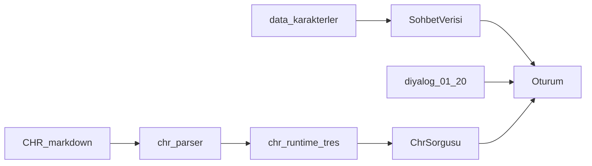

# Diyalog, karakter ve etki — ne belli, ne eksik

11 Ekim 2026. Kaynaklar: `Kapı_Muhafizi` oyun klasörü ve bu klasördeki `ROADMAP_2.md`, `USLUP_REHBERI.md`, `OZGUNLUK.md`. Oyun koduna dokunulmadı. Bu belge yol haritasına madde yazmaz. Sondaki delikler, Ahmet “yola yaz” derse işlenir.

Kısa hüküm: karakterin kim olduğu ve kapıda ne diyeceği sayfada ayrıntılı. O cümlenin köye, kasaya, sonraki kişiye ve ertesi geceye etkisi çoğunlukla düzyazı. Ayrıştırıcı alanı ayıklıyor. Gece motoru o alanı genel olarak okumuyor.

Üç ağız hâlâ ayrı çalışıyor. ROADMAP 2 bunları tek Söz motorunda birleştirmeyi vaat ediyor (DIY-16). Eski alanın yeni dosyada hangi alana düşeceği yazılmamış. Dördüncü bir biçim riski buradan geliyor.

---

## Bugün kapıda üç ağız

**Adsız yirmi diyalog.** `data/diyalog/diyalog_01_20.json`. Yirmisinin de `acilis` alanı var. Yirmisinde de ilk soru “Kimsin?”. `src/sistemler/oturum.gd` içindeki `_gemini_al()` dosyayı sırayla okur. Bitince gelen, sınıf şablonuna düşer. Karar etkisi o şablondan gelir. Kabulde şablonun bir barına rastgele +1 veya −1 eklenir (`_figur_gelen`). Hikâyedeki tohum, yanmış tarla veya saklanan kız bu bara yazılmaz.

**Adlı sohbet.** `data/sohbetler/` altında 40 `SohbetVerisi`. Onu adlı kişidir: Yusuf, Miraen, Thessra, Sorhan, Karaca Usta, Aydoğdu, Saruca Hatun, Ayşe Bacı, Hasan Çelebi, Nogay. Diğer otuz dosya CHR kopyasıdır. Ziyaret sayısına göre giriş ve açılış seçilir. Açılış, kapıya varır varmaz okunur. Sorular düz bir dizidir.

**CHR sorgu.** `karakterler/CHR_001.md` … `CHR_030.md`. `tools/chr_parser.py` bunları `data/chr_runtime/CHR_XXX.tres` yapar. Düğüm, ipucu kilidi, dört bayrak, tansiyon ve panik reti kapıdaki `ChrSorgusu` çalıştırır. Bu ağız oyuncunun gördüğü sorgudur.

Tasarım belgesi `design/gdd/karakter-sayfalari.md` hâlâ “Bölüm 5 ve ipucu nesneleri henüz bağlanmadı” diye açıktır. Ayrıştırıcı o bölümü veriye çevirir. Gece, o verinin küçük bir kısmını okur. Aşağıdaki kanıt bu ayrımı satırla gösterir.

---

## Kanıt

Beş iddia var. Her biri bir dosyaya bağlı.

### 1. Fadime’nin sayfası dolu, gecesi boş

`karakterler/CHR_017.md`. Fadime, Karayayla’dan sağmal çoban. Kocası ölmüş. Kayınbiraderi Recep, kızı Esma’yı ve iki koyunu miras diye istiyor. Kadın kızı keçe heybesine sarıp sınıra inmiş.

Sayfa şunları yazıyor:

- Geliş şartı: `Tur > 3 ve Moral < 6`.
- Heybe: çıngıraktaki saç kurdelesi `Clue_CHR017_Kurdele`, heybedeki çocuk `Clue_CHR017_HeybeCocuk`, göğüsteki süt lekesi `Clue_Görsel_CHR017_SutLekesi`.
- Bölüm 5, bayrak kapalıysa: üçüncü turda ağılda “Kayıp Çocuk”, beşinci turda meydanda “Heybe Dedikodusu”.
- Sır gizliyken kabul: dördüncü turda Recep ağıl kapısına dayanır. Moral −2, Güvenlik −1.
- Dört takip kişisi, sayfası olmayan kimliklerle: kabulde CHR_068 Sağmalcı Hatice, rette CHR_069 Recep, rüşvette CHR_070 Peynirci Gülizar, kışlada CHR_071 Nine Pakize.

Bu cümleler `gecikmeli_etkiler` ve `sonraki_spawns` alanına ayrışır. Gece Fadime için bir “Recep geldi” olayı doğurmaz. CHR_068–071 diye bir sayfa yok. Köydeki işi “ağılda sağarım” cümlesinden değil, çiftçi sınıfının genel rutininden gelir.

### 2. Sivaslı reçber adsız listenin birinci kaydı

`data/diyalog/diyalog_01_20.json`, `diyalog_01`. Sınıfı çiftçi. Açılış, sorulmadan okunur:

> Selam olsun. Doğudan geliyorum; tarlam yandı, elimde bu darı ile tohum kaldı. Tohumu kimseye vermem, toprağa veririm.

Sorular “Kimsin?”, “Nesin?”, “Kendini tanıt.”. Karar `ret`, `kabul`, `rusvet`. Etki, çiftçi şablonunun bar dizisidir. Tohumun ortak mı kişisel mi olduğu, kızın kapıda bekleyip beklemeyişi bu kaydın umurunda değildir. Söz Ağacı’ndaki Yusuf sahnesi bu dosyaya yazılmaz. İki metin yan yana durur, birbirini beslemez.

### 3. Doksan üç hayalet

`python -B tools/chr_parser.py --check` çıktısı: “Validated 30 pages; 93 external follow-up IDs (no source page yet).”

Her sayfa dört spawn yazmak zorunda (`on accept`, `on reject`, `on bribe`, `on jail`). Otuz çarpı dört, yüz yirmi satırdır. Kimlikler tekrar ettiği için benzersiz eksik sayfa 93’tür. `sonraki_spawns` alanı `src/veri/karakter_verisi.gd` içinde durur. Okuyan çalışma kodu `src/veri/chr_sozlesmesi.gd` doğrulamasıdır. Kapı kuyruğuna kimse eklenmez. Olmayan kişi vaat edilmiştir.

### 4. Karar matrisi kapıda yalnız rüşveti besler

Ayrıştırıcı Bölüm 5’ten beş statlık `karar_matrisi` kurar: Refah, Erzak, Güvenlik, Moral, Sağlık. `src/sistemler/chr_runtime_sinirlari.gd` bu sayıları −4…+4 aralığına kıskaca alır. Kıskaç, sayının köye yazıldığı anlamına gelmez.

`karar_verisi` çağrıları kapıda şunlardır:

- `src/arayuz/kapi_ekrani.gd`: rüşvetin kişisel akçesi ve eşya listesi.
- `src/sistemler/cift_kasa_dagitimi.gd`: yine rüşvet kaydı.

Adlı gelenin düğme etkisi `oturum.gd` içinde `k.etki(karar)` ile kadro dizisinden gelir. Fadime’nin “sır çözüldüyse Erzak +2, Moral +2” satırı bu düğmeye bağlanmaz. Sınıf şablonu ile kişi matrisi iki ayrı hesap olarak durur. Canlı olan, şablondur.

### 5. Gecikmeli etki yalnız iki suçta okunur

`src/koy/casus_gece_takibi.gd` içindeki `gecikmeli()`, karakterin `gecikmeli_etkiler` listesinde karar eşleşen ve seçilen statı negatif olan ilk kaydı döndürür. Bunu çağıran iki dosya vardır:

- `src/koy/kuyu_zehirleme.gd` — CHR_002 ve CHR_009 kabul veya rüşvetinden zehir.
- `src/koy/ambar_kundaklamasi.gd` — kundak kararının erzak bedeli.

Başka bir CHR’nin “Tur 4’te şu binada şu olay” cümlesi bu iki kapıdan geçmez. Fadime’nin Recep’i, Heybe Dedikodusu ve kayıp çocuk satırı bu yüzden dosyada kalır.

Ayrıştırıcı bina adını yaklaşık otuz kelimelik bir listeden tahmin eder (`tools/chr_parser.py`, gecikmeli olay bloğu). Cümle listeye uymazsa sayfa derlenmez. Uyarsa, olay yine de genel geceye yazılmaz. Tahmin ile uygulama birbirinin yerine geçmiş durumdadır.

---

## On üç adım

Her adımda sıra aynıdır. Önce o adımın başına ne konursa metin oyuna değer. Sonra bugün ne üretildiği, oyunda neyin işlediği, ROADMAP 2’nin ne vaat ettiği.

### 1. Kimlik

**Daha iyi olsun.** Sayfa “herkeste bir sır var” diye açılmasın. Zorunlu alan çekirdek olsun. Çekirdek `durust` veya `dinlenmek_isteyen` ise heybe ipucu şartı kalksın. Kadronun yaklaşık yüzde 40’ı bu iki çekirdekte kalsın. Hitap türünden en az birer kişi bulunsun: saygı, şefkat, alışkanlık, ağırlık, gülüş. İki kişi dört eksende aynıysa uyarı çıksın. Uyarı metni silmesin. Yazar gerekçe yazarak geçebilsin.

**Bugün ne üretiliyor.** `karakterler/OKU.md` otuz kişiyi birer cümleyle kilitler. Her sayfa aynı iskelettir: maske, gizlenen gerçek, üç dal, dört karar. `design/gdd/karakter-kadrosu.md` hâlâ altı adlı kişilik bir demo kadrosundan söz eder. Oyunda on adlı tres vardır. Çekirdek, yedi eksen ve sahne biçimi sayfada alan değildir.

**Oyunda ne işliyor.** Kapı, CHR için sorgu ağacını, adlı kişi için sohbet dizisini açar. “Bu insan dürüst mü, birini mi koruyor, sadece dinlenmek mi istiyor” sorusunu kod sormaz. Otuz sayfanın hepsi bir şey saklar. Kota tutmaz. Beşinci karakterde oyuncu kalıbı çözer.

**ROADMAP 2 ne vaat ediyor.** YAZ-03 ses kartı, YAZ-09 çekirdek ve kadro denetimi, `OZGUNLUK.md`. Vaad doğru. Eksik olan, bugünkü ayrıştırıcının “iki obje ve bir görsel ipucu şart” kuralıyla bu kotanın çarpışmasıdır. Dürüst kişinin sayfası, ipucu uydurulmadan derlenemez.

### 2. Arka plan

**Daha iyi olsun.** Doğum yeri, aile bağı ve kırılma olayı düzyazı kalsın. Yanına, oyunun okuyacağı üç kısa alan gelsin: kim anılır, hangi bina veya iş, hangi dünya haberi. “Yolda ne gördün” ve dedikodu bu alanları okusun. Gündüz ve gece cümlesi, o kişinin iş noktasına bağlansın. Bağlanmayan cümle sayfada durmasın.

**Bugün ne üretiliyor.** Bölüm 1 üç alanı zorunlu kılar. Fadime’de doğum Karayayla, aile Esma ve ölü koca, kırılma Recep’in kapıya dayanmasıdır. `Köy_içi_Davranış` gündüz ağılda sağma, gece keçe nöbeti diye yazar. Ayrıştırıcı bunu `secere_matrisi` ve `koy_ici_davranis` diye saklar.

**Oyunda ne işliyor.** Bu iki sözlük köy yapay zekâsında, dedikoduda ve “yolda ne gördün” konusunda okunmaz. `koy_ici_davranis` yalnız `karakter_verisi.gd` alanıdır. Köy rutinleri sınıf animasyonudur: çiftçi tarlada, çoban sürüde. Fadime’nin ağılı, metnin dediği ağıl değildir.

**ROADMAP 2 ne vaat ediyor.** YAZ-01 dünya kitabı arka planın dönemini taşır. DNY-02 haberin önce insan ağzından duyulmasını ister. DIY-11 kişi hafızasıdır. Hiçbiri `secere_matrisi` alanını bir okuyucuya bağlama kabulü koymaz. Arka plan yine yazarın cebinde kalabilir.

### 3. Kapıya geliş şartı

**Daha iyi olsun.** Sayfadaki şart ya gece seçicide işler ya silinir. “Moral < 6” yazılıp okunmuyorsa ölü cümledir. İşleyecek şartlar sınırlı olsun: tur, mevsim, bar eşiği, dünya olayı, yatak. Serbest cümle kabul edilmesin.

**Bugün ne üretiliyor.** Fadime’nin şartı `Tur > 3 ve Moral < 6`. Ayrıştırıcı `Tur > N` sayısını `en_erken_tur` yapar. Metnin tamamı `spawn_kosulu` dizesinde saklanır. `design/gdd/karakter-sayfalari.md` kural 2, bar eşiklerinin alınmadığını açıkça yazar. Oyun barlarıyla eşleşmediği için atılır.

**Oyunda ne işliyor.** `spawn_kosulu` ve `en_erken_tur` çalışma kodunda bir seçici tarafından değerlendirilmez. Alan vardır. Kapı kuyruğu onu sormaz. Fadime, moral yüksekken de düşükken de aynı kapıdan gelebilir. Yazarın koyduğu şart oyuncuya yalan söyler.

**ROADMAP 2 ne vaat ediyor.** KAP-16 gelen sayısını çekicilik, mevsim ve dünya olayıyla dağıtır. Boş gün ister. Kişi bazında “şu bar şöyleyse bu adam gelsin” kabulü yoktur. BUG-16 olayların bina ve nüfus şartıdır. Karakterin geliş şartı değildir.

### 4. Maske, heybe, görsel iz

**Daha iyi olsun.** İpucu üretmek bu adımda kalsın. Şema bakış bölgesini de taşısın: yüz, eller, çarık, giysi, yük, yanındakiler. Işık yoksa ayrıntı gizlensin. Kapıdaki hastalık belirtisi ayrı düğme olmasın. Aynı bakış `Clue_*` üretsin. Görselde olmayan ayrıntı “görsel bekliyor” diye listelensin.

**Bugün ne üretiliyor.** Obje 1, obje 2 ve görsel hata zorunlu. Her biri `Generate [Clue_…]` taşır. Fadime’de kurdele, heybedeki çocuk ve süt lekesi bu üçlüdür. Ayrıştırıcı anahtarı ve açıklamayı tres’e yazar.

**Oyunda ne işliyor.** Bu adım, sözün gerçekten oyuna değdiği az sayıdaki yerden biridir. Heybe paneli ve divan kanıtı bu anahtarları okur. Bakış bölgeleri, akşam karanlığı ve hastalığın aynı bakışa girmesi yoktur. İpucu tıklanınca açılır. Süzmek diye bir eylem yoktur.

**ROADMAP 2 ne vaat ediyor.** DYL-02 bakış, KOP-03 hastalığın o bakışın bir bölgesi olması, KAP-06’nın mevcut görsel hata verisinin aynı yoldan okunması. Vaad yerinde. Eski sayfanın “üç ipucu şart” kuralı, bakış şemasıyla yan yana yazılmamıştır. İkisi birden zorunlu kalırsa dürüst karakter yine ipucu uydurur.

### 5. Konuşma ağacı

**Daha iyi olsun.** Zorunlu evre yalnız varış ve karar olsun. Üç dal, kanıt dalı ve sır, çekirdek istiyorsa yazılsın. Seçenek metni regex ile temizlenmesin. Yazar metni ile koşul ayrı alanda dursun. Üslup denetimi bu hatta, uyarı olarak, derlemeden önce çalışsın. Açılışta hikâye okunmasın.

**Bugün ne üretiliyor.** Bölüm 4 sabit iskelet: düğüm 00, yol, geçmiş, kanıt, `Final_Ret`, karar menüsü. Ayrıştırıcı tırnak ve `Hedef:` satırından seçenek üretir. `Flag_` ve `Tansiyon` parantezlerini oyuncu metninden siler. Silme, metnin doğal olduğu anlamına gelmez. Üslup rehberi bu dosyalara bağlı değildir.

**Oyunda ne işliyor.** `ChrSorgusu` düğümü, kilitli seçeneği ve panik retini çalıştırır. Adsız JSON ve adlı sohbet başka biçimdedir. Üçü de “önce selam, hikâye sorulunca” kuralına uymaz. JSON açılışı hikâyeyi peşinen okur. Söz Ağacı prototipindeki Yusuf bu üç biçimin hiçbirine yazılmaz.

**ROADMAP 2 ne vaat ediyor.** DIY-01 Kapı usulü, DIY-03 selam önce, DIY-04 katman, DIY-16 eski yolların kapanması, YAZ-02 üslup. Eksik olan eşleme tablosudur: eski düğüm, sohbet soru dizisi ve JSON sorusu yeni Söz alanına nasıl gider. Tablo yoksa yeniden yazım dördüncü biçim olur, üçü de oyunda kalır.

### 6. Tansiyon, bayrak, zar

**Daha iyi olsun.** Dört bayrak kalsın. Yeni bayrak, çekirdek istiyorsa eklensin. Hepsi şart olmasın. Başlangıç tansiyonu 1–3 kalsın. Görünür zar bu aralıkların eki olsun. İkinci bir gizli olasılık hesabı kalmasın. Güven, tansiyonun yanına ikinci çubuk olarak gelsin. Sır güvenle açılırsa tam, korkuyla açılırsa eksik kalsın.

**Bugün ne üretiliyor.** Bayraklar sabittir: yol sırrı, kimlik, sır tamamen çözüldü, kilit. Başlangıç tansiyonu yalnız 1, 2 veya 3. Blöf ve ikna satırı `beceri` alanı alır. Başarı, oyuncunun görmediği bir olasılıktır.

**Oyunda ne işliyor.** Aralıklar çalışır: 0–3 sakin, 4–7 gergin, 8–10 panik. Panikte barışçıl kabul kapanır. Zar ekranda atılmaz. Güven diye bir değer yoktur. Aynı sır, nasıl açıldığına göre eksik veya tam bilgi bırakmaz.

**ROADMAP 2 ne vaat ediyor.** ZAR-01 d6 ve d12, üç kademe tansiyon eki, 1 her zaman başarısız, yüzün tavanı her zaman başarılı. ZAR-03 tansiyon 10’u aşınca kaçış. DIY-17 güven ve korku. KAP-09’un yerini zar alır. Eski olasılık formülünün hangi sürümde silineceği kabul satırında vardır. Bayrak listesinin çekirdeğe göre seyrelmesi yoktur.

### 7. Karar anı

**Daha iyi olsun.** Düğmenin yazdığı sayı, o kişinin `karar_matrisi` olsun. Sınıf şablonu yalnız adsız figürde kalsın. Sır açık ve sır gizli kabul iki ayrı etki taşısın. Rüşvet kişisel kasaya, kamu haracı kamu kasasına yazılsın. İkisi karışmasın. Matristeki stat, kıskaçtan sonra köy barına işlensin. İşlenmeyen satır doğrulayıcıda hata sayılsın.

**Bugün ne üretiliyor.** Her sayfada altı karar satırı zorunlu: kabul ve sır açık, kabul ve sır gizli, zorunlu ret, gönüllü ret, rüşvet, kışla. Fadime’de sır açık kabul ağıla iş ve iki artı stat verir. Sır gizli kabul, Recep’in gelişini yazar. Rüşvet peynir ve çıngırak alır, sonra süt eksiği doğurur.

**Oyunda ne işliyor.** Kanıt 4. Canlı düğme sınıf şablonudur. Matris kapıda rüşvet akçesi ve eşya listesidir. Beş stat köy barına yazılmaz. Adsız kabul, üstüne rastgele +1 veya −1 bindirir. Oyuncu tohuma veya kıza göre değil, çiftçi şablonuna göre ödüllenir veya cezalanır.

**ROADMAP 2 ne vaat ediyor.** DIY-02 motorun karar matrisini aynı API’den okumasını ister. ACL-05 yatak uyarısı, CAT kapı kavgası, EKO çift kasa durur. “Şablon değil, kişi matrisi düğmeye yazılır” diye ayrı bir kabul yoktur. Vaad motorun içindedir. Kapıdaki bugünkü kazanan hesap yazılmamıştır.

### 8. Gecikmeli sonuç

**Daha iyi olsun.** Bölüm 5 serbest cümle olmasın. Her satır `hedef_sistem`, alan ve değer taşısın. Hedef şunlardan biri olsun: bar, kuyu, ambar, dedikodu, spawn, kişi hafızası. Ayrıştırıcı bina adını tahmin etmesin. Bilinmeyen hedef sayfayı derlemesin. Gece, listedeki her satırı bir kez uygulasın. Yalnız iki suç dosyasına özel kapı kalmasın. Aynı olay iki kez yazılmasın.

**Bugün ne üretiliyor.** Ayrıştırıcı `Tur N`, “Debuff: N tur” ve bina listesinden `gecikmeli_etkiler` kurar. Fadime’nin Recep satırı bu listededir. Süre, gecikme sanılmasın diye kod yorumu düşülmüştür. Yorum, gece uygulamasının yerine geçmez.

**Oyunda ne işliyor.** Kanıt 5. Kuyu zehri ve ambar kundaklaması kendi dosyalarından bu listeye bakar. Başka satır okunmaz. Fadime’nin dördüncü turu gelmez. “Tur 3’te Kayıp Çocuk” diye yazılmış olay, olay havuzunda yoktur.

**ROADMAP 2 ne vaat ediyor.** DYL-08 dönüşleri KVR-08 kuyruğuna yazılır. KOP-04 ikinci kuyruk açmaz. İkisi de doğru kısıttır. İkisi de bugünkü listeyi geceye bağlayan kabulü koymaz. Kuyruk birleştirmek, boş kuyruğu doldurmak değildir.

### 9. Sonraki kişi

**Daha iyi olsun.** Spawn satırı ya gerçek bir sayfaya gitsin ya silinsin. Doksan üç hayalet bu kuralın ilk işidir. Dört spawn her karaktere şart olmasın. Çekirdek kimseyi çağırmıyorsa alan boş kalsın. Aynı yolun insanı, kişinin `baglar` alanından ve bu spawn kaydından, tek listeden gelsin.

**Bugün ne üretiliyor.** Kanıt 3. Her sayfa dört kimlik ve tur ofseti yazar. Eksik sayfa uyarıdır, hata değildir. Doğrulama “30 sayfa geçerli” der. Geçerli, o insanların var olduğu anlamına gelmez.

**Oyunda ne işliyor.** `sonraki_spawns` kapı kuyruğuna eklenmez. Recep, Hatice, Gülizar ve Pakize birer cümledir. `OZGUNLUK.md` bölüm 6 da bağ ister: Yusuf’un köyünden yedi ev, asılan adamın karısı. O bağlar da sayfada `baglar` alanı olarak durmaz. İki tarif vardır. İkisinin de okuyucusu yoktur.

**ROADMAP 2 ne vaat ediyor.** KOP-04 bağları `sonraki_spawns` alanına yazdırır. DIY-11 ve DIY-13 hafıza ile dedikoduya taşır. Kabul, Yusuf’un dönüşünün kayıtta tek satır olmasıdır. 93 kimliğin sayfaya dönüşmesi veya silinmesi kabulde yoktur. Alan birleşir, hayalet kalır.

### 10. Köyde hayat

**Daha iyi olsun.** Kabul edilen kişinin iş cümlesi, o köylünün iş noktası ve verim notu olsun. Cümle bir binayı işaret ediyorsa ve bina yoksa ISG uyarısı o cümleden gelsin. Açlık ve yorgunluk, kişinin adıyla görünsün. “Çiftçi tarlada” yeterli olmasın. Fadime ağıldaysa oyuncu onu ağıl dikdörtgeninin içinde görsün.

**Bugün ne üretiliyor.** Bölüm 1 gece ve gündüz cümlesi yazar. Bölüm 5 kabul satırı binayı adlandırır: Ağıl, Değirmen, Hendek. Bunlar tres’tedir.

**Oyunda ne işliyor.** Kabul, sınıfı köy nüfusuna yazar. Rutinler sınıfındır. Kişinin cümlesi iş noktasına bağlanmaz. Çiftçinin tarla dışında durması ayrı bir hatalıdır (BUG-23). O hata bile sınıf içindir, Fadime’nin ağılı için değildir.

**ROADMAP 2 ne vaat ediyor.** ISG-01 meslek uyarısı, ISG-02 geçici iş, YSM barlar, YAZ-08 köy içi sohbet, BUG-23 tarla noktası. Hepsi gereklidir. Hiçbiri `koy_ici_davranis` metnini okuma kabulü koymaz. Yeni iş listesi, eski cümlenin yanında ikinci bir iş tarifi olur.

### 11. Hafıza ve dönüş

**Daha iyi olsun.** `ziyaret` ve `son_karar` replik seçimine girsin. Dönüş selamı bu kayda göre değişsin. Dedikodu tek yazar olsun. Fısıltı gazetesi kendi olayını uydurmasın. Tanık yoksa satır çıkmasın. Eş, günün en ağır kararını bir kez sorsun. Aynı gece ikinci vicdan sahnesi açılmasın.

**Bugün ne üretiliyor.** Kadro, adlı karakter için ziyaret sayısı ve son kararı tutar. Tasarım bunu kayda yazar. CHR bayrakları ziyaretin içinde kalır. Geceye “bu adam şunu hatırlıyor” diye tek satır çıkmaz.

**Oyunda ne işliyor.** Replik seçimi `son_karar` kullanmaz. Fısıltı, yer adını binanın varlığından bağımsız kurabilir. Bu, BUG-17’nin düzelteceği hatalardandır. Dedikodu ile gazete iki ağızdır. Akşam eşi yoktur.

**ROADMAP 2 ne vaat ediyor.** DIY-11, DIY-13, KOP-05, DYL-07, BUG-17. Bu adımın vaadi yol haritasında en tamam olanlardandır. Eksik, bugünkü kadro kaydının Söz motoruna taşınırken silinmemesidir. İkinci bir hafıza sözlüğü açılırsa ziyaret sayısı iki yerde şaşar.

### 12. Yazım hattı

**Daha iyi olsun.** İnsan önce “kim bu insan” paragrafını yazsın. Model o paragrafı yazmasın. Sesli doğaçlama ham madde olsun. Biçime sokma, ayrıştırıcının reddetmeyeceği alanlara otursun: çekirdek, gerekiyorsa iki obje, gerekiyorsa bayrak, karar satırları, yapılandırılmış gecikmeli etki. Dört spawn şartı bu şemadan kalksın. Doğrulayıcı yasak kalıbı uyarı saysın, metni kendisi değiştirmesin.

**Bugün ne üretiliyor.** Üretim, markdown sayfanın elle yazılması ve `chr_parser.py` ile derlenmesidir. Üslup denetimi bu hatta yok. Söz Ağacı’ndaki `yapaylik.js` yalnız prototip sahnesini tarar. Otuz CHR sayfası o taramadan geçmez.

**Oyunda ne işliyor.** Derlenen tres kapı sorgusunu besler. Dünya kitabı, ses kartı ve onay imzası yoktur. Model ile insan aynı dosyada ayırt edilmez.

**ROADMAP 2 ne vaat ediyor.** YAZ-01…07: dünya kitabı, üslup, ses kartı, istem, pilot, dalga, doğrulayıcı. Sıra doğrudur. Pilot onaylanmadan toplu yazım yoktur (YAZ-05). Eksik bağ şudur: yeni JSON, bugünkü ayrıştırıcının zorunlu alanlarına nasıl düşer. Düşmezse Söz dosyası oyun dışı bir taslak kalır, kapı eski üç ağzı okumaya devam eder.

### 13. Prototip

**Daha iyi olsun.** Siteden indirilen sahne, ayrıştırıcının `--check` ile okuyabildiği bir dosya olsun. İndirme, üç eski biçimden birine de, yeni Söz şemasına da otursun. Oturmayan indirme “taslak” diye adlandırılsın ve oyuna kopyalanmasın. İkinci kişi, başka çekirdek ve başka sahne biçimiyle yazılmadan kör okuma yapılmasın. Tek ses, ses ayrımı sınavı değildir.

**Bugün ne üretiliyor.** `soz_agaci/` Yusuf’un ilk karşılaşmasıdır. Oyna, Ağaç, İnceleme, Şablon sekmeleri vardır. Güven, söz kesme, karşı soru ve yapaylık uyarısı çalışır. Sahne JS içindedir. Godot bu dosyayı okumaz.

**Oyunda ne işliyor.** Hiçbir şey. Prototip kasıtlı olarak oyunun dışındadır. Risk, prototipte onaylanan sahnenin kapıdaki üç ağızdan birine benzememesidir. Onay, oyunun onayladığı anlamına gelmez.

**ROADMAP 2 ne vaat ediyor.** A3 sırası: bağlam paneli, çelişki tahtası, bakış, akşam ve dönüş kartı, ikinci kişi, Yusuf’un dürüst çekirdeği, altın oynanış, en sonda yerinde düzenleme. DYL-16 iki motorun aynı kaydı oynamasını ister. Eksik olan, indirilen dosyanın `chr_parser.py --check` veya Söz şeması doğrulayıcısından geçmesidir. Altın oynanış, şeması olmayan bir sahneyi kilitler.

---

## Yola işlenmesi gereken delikler

Bu liste belgede kalır. `ROADMAP_2.md` bu turda değiştirilmedi. Oyun koduna dokunulmadı.

1. Çekirdek zorunlu olsun. Sır, çekirdeklerden yalnız biri olsun. Dürüst ve dinlenmek isteyen kişide heybe ipucu şartı kalksın. YAZ-09 ve DIY-01a.
2. Bölüm 5 satırı `hedef_sistem + alan + değer` olsun. Ayrıştırıcı bina adı tahmin etmesin. Gece, listeyi genel uygulasın. Kuyu ve ambar, listenin iki satırı olarak kalsın. Ayrı gece kapısı olmasın. KOP-04 ve DYL-08.
3. Doksan üç hayalet kimlik ya sayfa olsun ya spawn satırından silinsin. Dört spawn herkese şart olmasın. Olmayan kişi vaat edilmesin.
4. Karar düğmesi kişinin beş statlık matrisini yazsın. Sınıf şablonu yalnız adsız figürde kalsın. İşlenmeyen stat satırı doğrulayıcıda hata sayılsın.
5. Geliş şartındaki bar eşiği ya gece seçicide işlesin ya sayfadan silinsin. `Moral < 6` yazılıp okunmayan cümle kalmasın.
6. Üç diyalog biçimi için tek eşleme tablosu DIY-16 kabulüne girsin. Eski düğüm, sohbet sorusu ve JSON sorusu yeni alan adıyla yazılsın. Eşlemesi olmayan metin oyuna girmez.
7. Prototipin indirdiği dosya ayrıştırıcı veya Söz şeması doğrulamasından geçsin. Geçmeyen dosya taslak kalsın. DYL-16.
8. `secere_matrisi` ve `koy_ici_davranis` ya bir okuyucuya bağlansın ya sayfadan düşsün. Bağlanmayan arka plan, ikinci bir hikâye gibi durmasın.

Bu sekiz madde yeni mekanik değildir. Yazılmış olup okunmayan cümlenin ya işe girmesi ya silinmesidir.

---

# İkinci kısım — dünya keyfi ve sevilen karakter

Diyalog hattından bağımsız. Yeni bir ekonomi, harita veya romans yoktur. Keyif, bitmiş köyün içinde tekrar görme ve kaybedebilme hissinden gelir. Bu kısım da yol haritasına madde olarak yazılmadı. Ahmet “yola yaz” derse SEV kimlikleriyle girer.

## Dört koşul

Bir karakter ancak şunlar bir arada olursa sevilir:

- Oyuncu onu kapıdan sonra da görür.
- Onda başka kimsede olmayan bir ayrıntı vardır: isim, eşya, alışkanlık, iş.
- Kapıdaki kabulden başka, küçük ve isteğe bağlı bir iyilik mümkündür.
- Giderse veya ölürse köy o kişiyi kaybeder. Jenerik bir moral puanını değil.

Oyun favoriyi seçmez. Aynı dört koşul her çekirdekte çalışır. Bağlanan kişiyi oyuncu seçer.

## Hitap türleri

Kadrodan en az birer kişi:

- **Saygı.** İşini gözünle gördüğün usta. Haydar şifahanede, Karaca tezgâhta. Hediye menüsü yok. Saygı, işin görünmesinden gelir.
- **Şefkat.** Çocuk, yaralı, eş. Eş, senin kararını yargılayan tek yüz olsun. Bu oyunun Kim’i odur. Ayrı bir aşk sistemi değildir. Akşam sohbeti onun tekrar görüşüdür.
- **Alışkanlık.** Beceriksiz, zararsız, birkaç kez gelen biri. Yalanı kolay çözülür. Oyuncu onu bekler. Papers, Please’teki Jorji kalıbı budur.
- **Ağırlık.** Az konuşur, bir söz verir, tutar. Sofrada susup sonra tek cümle eder.
- **Gülüş.** Keçi, övünen seyis, hafif çekirdek. Gerilimi keser. Herkesin derdi ölüm değildir.

Bugünkü otuz sayfanın hepsi bir şey saklıyor. Bu beş türden dördü kadroda zayıf. Sevgi, sır çözmekten çıkmaz. Sır seven oyuncu da kalsın. Sır olmayan birini seven de kalsın.

## Güncel oyundan ne alınır

Alınacak his, alınmayacak sistem:

- Papers, Please: aynı yüz geri gelir. Evdeki insan senin kararını sorar.
- Hades: ilişki, hediye sayacından değil onu tekrar görmekten ilerler. Kapıdaki eşya köyde bir yerde durur.
- Pentiment: yemek ve iş başında iki cümle. Hasat şenliği ve ateş başı bunun yeridir. İkisi de oyunda vardır. Eksik olan, o ateşte oturanın adı ve senin kararındır.
- Spiritfarer: vedada o kişinin işi ve eşyası gider.
- Citizen Sleeper: bir kişinin tek isteği ve kısa bir gün penceresi. Görev günlüğü yok.
- Night in the Woods: ödülsüz vakit. Boş günde kuyruk yoktur. Köy vardır.
- Wildermyth: iki köylü birbirini sever veya çekemez. Kan davası oyunda vardır. Dostluk, o kaydın diğer ucudur. İkinci bir kavga sistemi açılmaz.
- Disco Elysium: dinlemek bir ödüldür. Her sır bir silah olmak zorunda değildir.

Alınmayacaklar: Stardew hediye takvimi ve kalp metre, romans, parti sohbet tekerleği, üs dekore etme, sonsuz prosedürel köylü, seslendirme, ikinci bir strateji haritası. Harita duruyor. Mektup, o haritadan, tanıdığın birinin ağzıyla gelir. Yeni haber güvercini icat edilmez.

## Yedi iş

Hepsi var olan bir sistemin üstüne oturur. Hiçbiri o sistemi yeniden kurmaz.

1. **Boş gün, köy günü.** Kimse gelmeyince oyuncu ateş başına veya bir tezgâha yürür. İki satır duyulur. Ödül yok. Kapı gerilimdir. Boş gün keyiftir. Gelen akışı KAP-16’dadır. Bu iş o akışın boş gününde ne yapılacağıdır.
2. **Tanıdık yüz.** İçeri alınan kişi bazı geceler kuyruğa değil, ateşe veya kapının iç yanına gelir. Selam son kararı ve somut bir anıyı kullanır. Kadroda iki veya üç kişi bilerek tekrar gelir. Tehlikeli değildir. Oyuncu onları bekler.
3. **Kişisel iz.** Kapıda görülen eşya köyde bir yere konur. Fadime’nin kurdelesi ağıl direğindedir. Rüşvetle alınan eşya muhafız odasında durur ve ekşidir. Gönüllü verilen lokma aynı rafta durur ve sıcaktır. Kişi ölünce iz kalkar. Oda envanteri bunun yeridir. İkinci bir müze açılmaz.
4. **Tek istek.** Kişi bir kez bir şey ister. Süresi günle sınırlıdır. Tutmak isteğe bağlıdır. Tutulmazsa bir satır değişir. Belki gider. Görev listesi açılmaz. Fadime, Recep gelirse çevrilmesini ister. Usta, sessiz bir köşe ister.
5. **Birbirlerine bağ.** Aynı yoldan gelen iki kişi aynı binada oturur. Verime küçük bir fark ve duyulan bir cümle yazılır. Oyuncu insanı, insanın insanı sevdiğini görünce sever.
6. **İsim ancak sorulunca.** Maskeyle gelen, köyde maske adıyla anılır. Gerçek ad sorulmuşsa yüzen kart o ada döner. Sorulmamışsa dönmez.
7. **Veda kişiye aittir.** Cenaze o adı söyler, izi kaldırır, onun işlediği tezgâh bir gün boş kalır. Moral −1 yetmez. Cenaze akışı yeniden yazılmaz. Eksik olan, törenin hangi kişiye ait olduğudur.

Eş bu yedinin içindedir. Küçük iyilik, ona gerçeği söylemek veya susmaktır. Kalp puanı, hediye envanteri, düğün mini oyunu, her karaktere bir tema şarkısı ve herkese bir sadakat görevi sevgisi görev yapar. Bunlar eklenmez.
