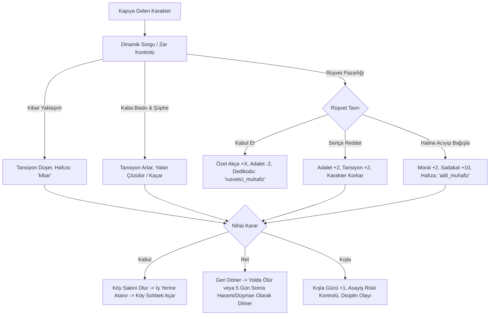

# Kapı Muhafızı — Diyalog Ana Planı ve Karakter Tasarım Sözleşmesi

> **Hazırlayan:** Antigravity (Ahmet ve Kaşif direktifiyle, Görev 3 Aşama A)  
> **Tarih:** 3 Kasım 2026  
> **Dal:** `feature/diyalog-yeniden-yazim`  
> **Kapsam:** Kapı Ziyaretçileri (CHR_001–030 ve diyalog_01–20), Adlı Karakterler (10 kişi), Köy İçi Sekanslar ve Tıklayınca Muhabbet (Parley).

---

## 1. Karakter Envanteri ve İnsanlaştırma Kılavuzu

Mevcut diyalogların en temel sorunu; karakterlerin birer canlı insan, 13. yüzyıl Anadolu Selçuklu / uç beyliği dönemi ferdi gibi değil, oyuncuya kuru bilgi aktaran "bilgi kutuları" gibi konuşmasıdır. Özellikle kapıdaki yirmi diyalogda istisnasız her karakterin "Kimsin? / Nesin? / Kendini tanıt." üçlüsüyle sorgulanması oyunu mekanikleştirmiştir. 

Yeni diyalog felsefemizde:
- **Her sesin bir coğrafyası ve yaşanmışlığı vardır:** Dağlı harami sert ve boğuk, ova çiftçisi tevekkül içinde ama toprağına kıskanç, şehirli Ahi esnafı ölçülü ve pazarlıkçı, Bizans/Rum göçmeni çekingen ve kırık Türkçeli, kışla kaçağı ise daima tetiktedir.
- **Yalan ve Saklama:** Kimse kapıda durduk yere tüm sırrını dökmez. Karakterler önce yalan söyler veya gerçeği eğer; ancak eşya, yara veya çelişki yüzüne vurulduğunda çözülür ya da saldırganlaşır.
- **Duygusal Tepkisellik:** Oyuncu kaba konuştuğunda gururu kırılır, rüşvet reddedildiğinde korkar ya da kinlenir, merhamet gördüğünde ise bunu unutmaz.

### 1.1. Kapı Ziyaretçileri: Adsız Halk (`diyalog_01` – `diyalog_20`)

| ID | Kim & Meslek | Ses / Ağız Özelliği | Derdi & İhtiyacı | Gizlediği Sır / Zaaf | Mevcut Hata & İyileştirme |
|---|---|---|---|---|---|
| `diyalog_01` | Erzincanlı yanık rençber (Çiftçi) | Yavaş, boğuk, toprağına yanan ova Türkmeni. "Toprak küsmez, insan küser oğul..." | Moğol akınında yanan tarlasından kaçırdığı son darı ve tohumu ekecek bir karış toprak arar. | Kesesindeki tohum beylik ambarından aşırmadır; yakalanırsa asılmaktan korkar. | Kuru 3 soru var. "Kimsin/Nesin" birleştirilmeli; göğsündeki tohum kesesi ve yanık kokusu sorgulanmalı. |
| `diyalog_02` | Kayserili çuhacı (Esnaf) | Hızlı, hesapçı, kelimeleri tartan çarşı esnafı. "Kırk yıllık tezgâh kül oldu da şu çuha kaldı elimde." | Son kumaş topunu satıp köyde tezgâh açmak. | Kumaşın içinde yağmalanan dükkânından sakladığı 12 gümüş dirhem gizlidir. | "Kimsin/Kendini tanıt" aynı. Çuha topunun ağırlığı ve nereden kaçtığı doğrudan sorulmalı. |
| `diyalog_03` | Sivas bozgunu neferi (Asker) | Kırık, öfkeli, yorgun kışla dili. "Sultan uzakta, pusat kırık, can boğazda..." | Kırık kargısına yaslanarak bir kase sıcak aş ve revir köşesi bulmak. | Ordudan firar etmiştir; arkasından gelen cezalandırma bölüğünden ödü kopar. | Robotik soru kalıbı kaldırılmalı; kargının kırığı ve firar şüphesi üzerine seçenekler kurulmalı. |
| `diyalog_04` | Yaylası yanan çoban (Çiftçi) | Sade, hayvanıyla dertleşen yaylacı. "Ak koyun yol bilmez, Kara koyun dert dinlemez." | İki cılız koyununa otlak ve güvenli bir ağıl bulmak. | Koyunlardan biri çiçek/uyuz başlangıcı taşır; köy sürüsünü kirletebilir. | "Koyunların adı ne" gibi çocuksu soru yerine hayvanların sağlığı ve dağdaki duman sorulmalı. |
| `diyalog_05` | Örssüz demirci kalfası (Esnaf) | Tok, sert, maden isi kokan Ahi çırağı. "Körük ciğer gibidir, nefesi bitti mi demir soğur." | Sönen ocağının ardından yeni bir körük ve örs bulup nal dövmek. | Ustasını Moğol süvarileri basınca geride bırakıp kaçmıştır; vicdan azabı çeker. | Pasif sorular yerine isli eller ve terkedilen atölye dramı öne çıkarılmalı. |
| `diyalog_06` | Miğferi yamuk piyade (Asker) | Alaycı, canından bezmiş sınır eri. "Kılıç karın doyurmaz gardaş, ekmek doyurur." | Kılıcını ekmeğe satmış; silahsız nöbet tutabileceği bir kapı arar. | Kılıcı satmamış, eşkıyaya haraç olarak kaptırmıştır; silahını kaybetmenin utancı vardır. | Boş kın ve yamuk miğfer görsel ipucu olarak doğrudan diyaloğa yedirilmeli. |
| `diyalog_07` | Sabanı kırık rençber (Çiftçi) | Çaresiz, elleri nasırlı yaşlı çiftçi. "Teker kırıldı, öküz çatladı, geriye şu arpa kaldı." | Son bir avuç arpayı toprağa atıp baharı görebilmek. | Arpa tohumu küflenmeye başlamıştır; ekilmezse üç güne çürüyecektir. | Bilgi verici replikler yerine ekmek kavgası ve kırık sabanın hikayesi gelmeli. |
| `diyalog_08` | Kunduracı/Dikici çırağı (Esnaf) | Mütevazı, gözleri dikişten yorulmuş esnaf. "Çarık delinir, yol bitmez." | Kapı dibinde de olsa köylünün çarığını onarıp karnını doyurmak. | Heybesinde kaçarken bir zenginin konağından düşen gümüş bir toka saklar. | Çok kuru geçen "Deri delerim" yerine heybedeki garip metal parıltısı sorgulanmalı. |
| `diyalog_09` | Oku tükenmiş kemankeş (Asker) | Keskin bakışlı, az konuşan uç okçusu. "Yay kirişi gergin, sadak boş. Ok olmadan kemankeş nedir?" | Yayını köyün kulesinde nöbete adamak, karşılığında barınmak. | Son okunu dost bildiği hain bir nöbetçiye atmıştır; intikam peşindedir. | "Kimsin" kaldırılıp doğrudan boş sadağın ve parmaklarındaki zihgirin hesabı sorulmalı. |
| `diyalog_10` | Testili yetim obalı (Çiftçi) | Sessiz, yutkunan, kederli genç. "Yarım somun ekmek iki yetimin kursağına gitti; bende testi kaldı." | Kuruyan obasından sonra bir damla temiz su ve başını sokacak saçak. | Testideki su değil, obanın kutsal saydığı son bağ kütüğü şırasıdır. | Sorular daha derin bir merhamet sınavına dönüştürülmeli. |
| `diyalog_11` | Yaralı köprü nöbetçisi (Asker) | Hırıltılı soluyan, kolu kanlı levent. "Bendi tuttuk tutmasına da... Taş köprü sele değil ata yenildi." | Oktan yaralı kolunu sardırmak, yaklaşan süvari haberini vermek. | Boğazdaki birliğin nerede dağıldığını tam bilmez; korkup erken çekilmiştir. | Kuru soru dizisi yerine yaranın durumu ve askeri istihbarat dalları konulmalı. |
| `diyalog_12` | Gezgin bakırcı/kalaycı (Esnaf) | Şakacı ama gözleri tekinsiz zanaatkar. "Bakır çalar, aş kaynar. Köyün tenceresi benden sorulur." | Eşeği ve bakır taslarıyla köyde seyyar kazan kalaylamak. | Eşeğin sırtındaki çifte tabanlı kazanda kaçak cıva ve kalay tozu gizler. | Rüşvet olarak önerdiği tasın meşruiyeti ve kaçak maden sorgulanabilmeli. |
| `diyalog_13` | Topal oğlaklı çoban (Çiftçi) | İnatçı, şefkatli, dağ rüzgarı yemiş keçi çobanı. "Sağlam olan dağa kaçtı; bu topalın bir benim kucağım vardı." | Kucağındaki yaralı oğlağı yaşatmak ve köy ağılında çırak durmak. | Sürüyü kurt değil, borçlu olduğu haramiler basmıştır; izini sürerler. | Seçeneklerde oğlağın durumu ve çobanın sadakati sınanmalı. |
| `diyalog_14` | Kaya tuzu tüccarı (Esnaf) | Boğazı tuzdan çatlamış, yorgun kervancı. "Tuzsuz aş, imansız baş olmaz derler ya muhafız..." | Kervanı dağılmış; kuşaktaki has kaya tuzunu köy ambarına satmak. | Tuzun bir kısmı barut yapımında kullanılan güherçile ile karışmıştır. | Tuzun kalitesi ve kervanın nerede vurulduğu üzerine dallar açılmalı. |
| `diyalog_15` | Kaçak kule borazancısı (Asker) | Titrek, nefesi daralan gözcü neferi. "Boruyu çaldım... Çaldım da ovada toplanacak er kalmamıştı." | Baskından kurtardığı borazanla köy surunda nöbet tutmak. | Kuleyi ateşe verenlerin arasında kendi kanından birini görmüş ve susmuştur. | Korkaklık mı vazife mi ayrımı keskinleştirilmeli. |
| `diyalog_16` | Asma fidanlı bağcı (Çiftçi) | Toprağa aşık, elleri kök çamuruyla sıvanmış ihtiyar. "Kökü bezde sakladım. Üç yıla üzüm verir; sabrı olan var mı?" | Bağ fidanını köyün güney yamacına dikip ortakçı olmak. | Fidan özel bir şaraplık üzüm aşı çubuğudur; softaların tepkisinden çekinir. | Zaman ve yatırım temalı zengin diyalog dalları kurulmalı. |
| `diyalog_17` | Dirhemleri şakırdayan kantarcı (Esnaf) | Titiz, her şeye şüpheyle bakan çerçi. "Terazi doğru tartar da tartan el düzgün müdür muhafız?" | Dirhemleri ve el terazisiyle köy meydanında adil pazar kurmak. | Dirhemlerinden biri hafif zımparalanmıştır (hileli dirhem). | Hileli tartı ve adalet barı doğrudan diyalogda sınanmalı. |
| `diyalog_18` | Kireç lekeli kale ırgatı (Çiftçi/İşçi) | Kamburu çıkmış, kaba ve açık sözlü beden işçisi. "Kireç eti yakar, taş omzu çökertir. Ama duvar dik durur." | Sur tamirinde, hendek kazısında kürek sallamak, kuru ekmek yemek. | Kale komutanının taş çalma yolsuzluğunu görmüş, susturulmak için dövülmüştür. | Omzundaki morluk ve kale dedikodusu kilit açmalıdır. |
| `diyalog_19` | Teknesi sırtında fırıncı (Esnaf) | Un kokan, telaşlı, ekmek sevdalısı usta. "Ekmek külde de pişer muhafız, yeter ki un olsun, ocak tütsün." | Sırtındaki gürgen tekneyle köy fırınında somun dökmek. | Un torbasında son ekmekten arta kalan zehirli çavdar mahmuzu şüphesi vardır. | Kıtlık, un kalitesi ve fırın ocağı dalları eklenmeli. |
| `diyalog_20` | Ayağına çivi batmış nalbant (Esnaf) | Acıdan dişlerini sıkan, eli çekiçli soğuk demirci. "At kendi nalını bana ödetti muhafız; basamıyorum gayrı." | Topuğunu sardırmak, kışlanın ve köylünün bineklerini nallamak. | Nalladığı son at bir harami beyine aittir; nalın üstünde çete damgası vardır. | Naldaki damga ve yaralı ayak gerilimi kurulmalı. |
| `diyalog_21` | Seyyid Burhan - Kalenderi derviş (Çiftçi/Gezgin) | Sakin, bilge, kinayeli sufi dili. "Yolcuya kapı, taşa toprak sorulmaz muhafız..." | Obası basılan yayla çobanının anasından müjde getirmek, köy tekkesinde hasır bulmak. | Cübbesinin astarında Moğol ulağından kalan gizli ipek fermanı taşır. | Yayla çobanı `diyalog_04` ile derin bağ kurulmalı; ferman sırrı açılabilmeli. |
| `diyalog_22` | Hacı Bedreddin - Tebriz tüccarı (Esnaf) | Fısıltılı, iltifatkâr, kurnaz Şark tüccarı. "Tebriz kervanından tipi yüzünden koptum..." | Dağda dökülen katırlarını nallatmak, safran ve ipek satmak. | Boynunda Moğol gümüş payzası taşır; casusluk şüphesi vardır. | `diyalog_02` Kayserili çuhacının kumaşlarını çalmakla suçlar; yüzleşme gerilimi. |
| `diyalog_23` | Sungur Çavuş - Sancak inzibatı (Asker) | Sert, buyurgan, tehditkâr kışla dili. "Sancak subaşısı buyruğudur; firarileri teftişe geldim!" | Kösedağ firarilerini yakalamak ya da kelle başına altın rüşvet koparmak. | Elindeki sancak fermanının mührü tahrif edilmiştir; kendi başına şantaj yapar. | Doğrudan `diyalog_03` ve `diyalog_06` neferlerini arar; köyün kışla nizamını sınar. |
| `diyalog_24` | Gülhatun - Vebalı ana (Çiftçi) | Hırıltılı, titrek, ölüm döşeğinde fedakar ana feryadı. "Şu kundaktaki sabiye acıyın..." | Kundaktaki 3 aylık bebeğini vebadan kurtarıp sütanneye emanet etmek. | Boynundaki veba çıbanı ölümcüldür; köye girerse salgın riski doğurur. | Şefkat ve köy sağlığı çatışması; kireç ocağında karantina seçeneği. |
| `diyalog_25` | Dursun - Kaçak fırın çırağı (Çiftçi/Yetim) | Ürkek, hızlı, çocukça yalvaran sokak dili. "Fırıncı her gece falakaya yatırırdı..." | Erzincan fırıncısının meşe sopasından kaçıp başını sokacak ocak bulmak. | `diyalog_01` rençber Hamza'nın öldü sandığı öz yeğenidir! | Hamza rençberle kavuşma; köy fırınında odun ve hamur iş gücü. |
| `diyalog_26` | Hekim Lokman - Gezgin otacı (Esnaf) | Şarlatan ile bilge arası, Latince/Arapça serpiştiren dil. "Kemiği sızlayana derman sunmaya geldim." | Kurutulmuş ot, merhem ve neşterle köy şifahanesinde tabiplik yapmak. | Heybesinde köylüyü uyutup soymak için hazırladığı zehirli afyon şurubu vardır. | `diyalog_11` köprü leventinin kangren olan yarasının sorumlusudur; Miraen ile çatışır. |
| `diyalog_27` | Molla Şükrü - Azledilmiş kâtip (Esnaf) | Sinsi, hukuki kılıflar uyduran bürokrat dili. "Hak söyleyen dokuz köyden kovulur..." | Şer'i hüccet ve tapu tahririyle köy meclisinde nüfuz kazanmak. | Sandığının altında köylünün tarlalarına çökmek için sahte vakıfnameler taşır. | Köydeki kâtip Hasan Çelebi'nin eski hasmıdır; iki kâtip arasında belge savaşı. |
| `diyalog_28` | Banu Hatun - İntikam savaşçısı (Asker) | Kısık, keskin, matem dolu Türkmen savaşçı sesi. "Kan borcumu almaya geldim!" | Öldürülen harami ağabeyinin atına zehirli çivi çakan hain nalbantı bulmak. | Belinde yangın fitili ve zehirli hançer taşır; adaletsizlikte köyü yakmaya and içmiştir. | `diyalog_20` nalbant ile doğrudan yüzleşir; kışlaya alınırsa güçlü nöbetçi olur. |
| `diyalog_29` | Kervancı İlyas - Kafile habercisi (Çiftçi) | Öfkeli, sitemkâr, ayazda donmuş kervan dili. "Kırk canın çığlığı vadide yankılanıyor!" | Kapıdan kovulan kafilenin karda donduğunu yüzümüze vurmak; sedye ve çorba istemek. | Geri çevrilen kararların acı sonucudur; ambarı açtırmak için kurnaz bir sınavdır. | Önceki ret kararlarının ahlaki bedeli; ambardan yardım veya pusu şüphesi. |
| `diyalog_30` | Turna Hatun - Muhafızın yeğeni (Çiftçi) | Sıcak, hüzünlü, ata ocağı anılarıyla yüklü samimi ses. "Babam 'Git amcanın kapısına sığın' dedi..." | Erzincan'daki ata ocağı yanınca tek başına kaçıp amcasının kapısına sığınmak. | Peşinde kendisini zorla konağa kapatmak isteyen sancak voyvodasının süvarileri vardır. | Muhafızın ve eşin kan bağı imtihanı; `diyalog_25` Dursun ile kardeş oldukları ortaya çıkar. |

---

### 1.2. Adlı Karakterler (Sohbet Kadrosu & Köy Sakinleri)

1. **Yusuf (Yetim Keçi Çobanı, 12 yaş):**
   - *Sesi:* İnce, kırılgan, zaman zaman çocukça inatçı, yalnız kaldığında titreyen ses.
   - *Derdi:* Kösedağ'da kaybolan babasını ve yolda ölen annesini bekler. Elindeki iple kaçan keçisi "Karabaş"ı arar.
   - *Sırrı:* Aslında keçinin kurtlar tarafından parçalandığını görmüştür ama bunu kendine itiraf edemez; ipi bırakırsa ailesinden kalan son bağın kopacağına inanır.
   - *Köydeki Yeri:* Ağıl veya meydan çınarı altı. Köy çocuklarıyla oynamaz, gözü hep sınır kapısındadır.

2. **Miraen (Rum İpekçi & Şifacı Kadın):**
   - *Sesi:* Ağdalı, yumuşak, kelimeleri dikkatle seçen kırık Selçuklu Türkçesi. "Biz dağın bu yüzünü de öte yüzünü de biliriz muhafız..."
   - *Derdi:* Kilise ile tekke arasındaki sınırda kimseye yaranamamak; ilmini ve ipek boyama sırrını aktaracak bir çırak bulmak.
   - *Sırrı:* Bizans sınırından kaçırılan eski ikona ve tıp yazmalarını bohçasında gizler.
   - *Köydeki Yeri:* Şifahane veya bostan arkasındaki gölgelik sundurma.

3. **Thessra (Taş Ustası & Mimar Kalfası):**
   - *Sesi:* Tok, matematiksel düşünen, az ve öz konuşan usta dili.
   - *Derdi:* Depremde çatlayan sur duvarlarını ve su kemerlerini onarmak.
   - *Sırrı:* Köyün altından geçen eski bir Bizans tonozlu mahzen yolunu fark etmiştir.
   - *Köydeki Yeri:* Taş ocağı ve sur dibi tamirat noktası.

4. **Sorhan (Kıpçak At Terbiyecisi & Levent Firarisi):**
   - *Sesi:* Bozkır gırtlak tonlu, serkeş, at kişnemesi gibi ansızın sertleşen ses.
   - *Derdi:* Atların dilinden anlar; kışlada haksız yere kırbaçlanan arkadaşının intikamı için kaçmıştır.
   - *Sırrı:* Askeri tahrir defterinde adı "firari ve katil" olarak geçer.
   - *Köydeki Yeri:* Kışla ahırı veya çit kenarı.

5. **Karaca Usta (Ahi Demirci Reisi):**
   - *Sesi:* Gür, vakur, ocak ateşi gibi harlı, fütüvvet ahlakını gözeten usta. "Haram akçeyle alınan demir su tutmaz oğul!"
   - *Derdi:* Köyde zanaat ahlakının bozulması, kalitesiz madenle iş yapılması.
   - *Sırrı:* Sancak beyinin gizli silah siparişini "haksız savaş" diye reddettiği için dükkanı mühürlenmiştir.
   - *Köydeki Yeri:* Köy demirhanesi.

6. **Aydoğdu (Eski Kalkan Başı, Emekli Çavuş):**
   - *Sesi:* Emir vermeye alışkın, kaba, sigara/tütün ve köz kokan kışla ihtiyarı.
   - *Derdi:* Genç muhafızların gevşekliği, kapıdaki asayiş zaafı.
   - *Sırrı:* Sağ kulağı bir mancınık patlamasında tamamen sağır olmuştur; dudak okuyarak idare eder.
   - *Köydeki Yeri:* Gözcü kulesi dibi ve kışla önü.

7. **Saruca Hatun (Köy Ocağının Anaç Reisi):**
   - *Sesi:* Sevecen ama tavizsiz, Anadolu anası sesi. "Aç karın doyar da aç göz doymaz."
   - *Derdi:* Kışlık zahirenin yetip yetmeyeceği, köydeki bebelerin ve dulların hakkı.
   - *Sırrı:* Kıtlık zamanı için ambarın altına gizli bir tahıl sandığı gömmüştür; muhafızdan bile saklar.
   - *Köydeki Yeri:* Ekmek fırını ve ambar civarı.

8. **Ayşe Bacı (Bacıyan-ı Rum Teşkilatçısı & Dokumacı):**
   - *Sesi:* Kararlı, örgütleyici, hakkını arayan bilge kadın sesi. "Kadının tezgâhı erkeğin kılıcından keskindir."
   - *Derdi:* Köy kadınlarının emeğinin sömürülmesini engellemek, dayanışma sandığı kurmak.
   - *Sırrı:* Haramilere karşı kadınlardan gizli bir hançerli muhafız birliği eğitmektedir.
   - *Köydeki Yeri:* Dokuma tezgâhı veya meydan çınarı.

9. **Hasan Çelebi (Sürgün Edilmiş Divan Kâtibi):**
   - *Sesi:* Tereddütlü, fısıltılı, mürekkep kokan bürokrat dili.
   - *Derdi:* Başına buyruk beylerin usulsüzlüklerinden kaçmak, hayatta kalmak.
   - *Sırrı:* Koynunda beyliğin rüşvet ve vergi kaçakçılığı şebekesini belgeleyen gizli bir defter sayfası taşır.
   - *Köydeki Yeri:* Divan/Meclis çadırı veya muhafız odası yanı.

10. **Nogay (Bozkır Gözcüsü & İz Sürücü):**
    - *Sesi:* Kısık, rüzgâr uğultusu gibi, kesik cümlelerle konuşan avcı. "İz yalan söylemez. İnsan söyler."
    - *Derdi:* Dağdaki kurtların ve yaklaşan harami fırkalarının ayak sesini dinlemek.
    - *Sırrı:* Vaktiyle Kızıl Karga çetesine kılavuzluk yapmıştır; o günlerin bedelini vicdanıyla öder.
    - *Köydeki Yeri:* Köy çeperleri, orman sınırı.

---

## 2. Büyük Seçim–Sonuç Haritası (Choice & Consequence)

Oyuncunun kapıda ve köyde vereceği her karar rastgele sayı üreticisine değil, birbirini besleyen organik dört ana sütuna bağlıdır:
1. **Dört Köy Barı:** `Moral` (0-100), `Adalet` (0-100), `Akçe` (Kamu/Özel kasa), `Asayiş Riski` (0-100).
2. **Kişi Hafızası (`KisiHafizasi`):** Karakterin kapıda uğradığı muamele (`kibar`, `kaba`, `sorguda_ezilmis`, `rusvet_alindi`, `haksiz_ret`, `yardim_edildi`).
3. **Köy Fısıltısı ve Dedikodu (`Dedikodu`):** Kapıdaki bir olaya şahit olanların (tanıkların) 1–3 gece sonra köy kahvesinde ve meydanda bunu yayması.
4. **Gecikmeli Olay Tetikleri:** Gece kartlarına (`OlayVerisi`) ve köy içi dinamiklerine yazılan bayraklar (`Flag_...`).

### 2.1. Dinamik Karar & Tepki Matrisi



### 2.2. Kapsamlı Karar ve Sonuç Tablosu

| Karakter Tipi / Durum | Oyuncunun Seçimi | Anlık Etki (Bar & Tansiyon) | Yazılan Hafıza & Bayrak | 1–3 Gece Sonraki Sonuç (Köy / Kapı) |
|---|---|---|---|---|
| **Erzincanlı Çiftçi (`diyalog_01`)** | Tohumu zorla alıp içeri sokmak | Akçe +2, Adalet -2, Tansiyon +3 | `hafiza: zorba_muhafiz`, `Flag_Tohum_Musadere` | Köyde "Muhafız köylünün tohumuna el koydu" dedikodusu yayılır, çiftçilerin iş verimi %15 düşer. |
| **Erzincanlı Çiftçi (`diyalog_01`)** | Tohumuyla kabul edip tarla vermek | Moral +2, Erzak İhtiyacı +1 | `hafiza: nimet_kapisi`, `Flag_Bereketli_Ekim` | 4. gecede tarlada `harman` olay kartı açılır, ambar erzağı +4 artar. |
| **Sivas Bozgun Askeri (`diyalog_03`)** | Firarını yüzüne vurup kovmak | Adalet +1, Asayiş -1 | `hafiza: intikam_yemini`, `sonraki: CHR_001_cetesi` | Boğazda haramilere katılır; 6. gece köy kapısına keşifçi olarak geri döner. |
| **Sivas Bozgun Askeri (`diyalog_03`)** | Kışlaya alıp yarasını sardırmak | Güvenlik +2, Erzak -1 | `hafiza: sadik_nefer`, `Flag_Kule_Nöbetcisi` | Gece kurt baskınında kuledeki gözetlemesi sayesinde baskın zayiat vermeden savuşturulur. |
| **Kalaycı Esnaf (`diyalog_12`)** | Sarı tası rüşvet alıp geçirmek | Özel Kasa +3, Adalet -3 | `dedikodu: rusvet_saritas`, `hafiza: satin_alinmis` | Dedikodu 2. gece Ahi meclisine ulaşır; Karaca Usta muhafıza yüz çevirir, alet tamir masrafı ikiye katlanır. |
| **Topal Oğlaklı Çoban (`diyalog_13`)** | Çobanı alıp oğlağı kestirmek | Erzak +1, Moral -3, Tansiyon +4 | `hafiza: cocuk_katili`, `Flag_Oglak_Kesildi` | Çoban gece ağıldan kaçar, köyün çit kapısını açık bırakır; kurtlar sürüye dalar. |
| **Topal Oğlaklı Çoban (`diyalog_13`)** | Oğlakla beraber içeri almak | Moral +3, Erzak -1 | `hafiza: merhametli_bey`, `Flag_Coban_Sadakat` | Yusuf ile çoban dost olur; Yusuf'un morali tavana vurur, köyde çobanlık verimi artar. |
| **Kantarcı Esnaf (`diyalog_17`)** | Hileli dirhemini fark edip kırmak | Adalet +4, Tansiyon +2 | `hafiza: keskin_goz`, `Flag_Adil_Pazar` | Pazar yerinde esnaf tartıda hile yapmaya cesaret edemez; köy refahı +5 artar. |

---

## 3. Kaldırılacak ve Birleştirilecek Seçeneklerin Dökümü

Mevcut sistemdeki yapaylığı temizlemek adına aşağıdaki budama ve birleştirme kuralları uygulanacaktır:

### 3.1. Kaldırılan / Birleştirilen Dallar
1. **"Kimsin?" ve "Kendini tanıt" İkilemi:**
   - *Gerekçe:* Neredeyse tüm diyaloglarda "Kimsin?" soru kalıbı ile "Kendini tanıt" soru kalıbı aynı cevabın iki farklı cümlesini vermektedir (Örn: "Toprak adamıyım" vs "Ne önemi var, bir garibim").
   - *Çözüm:* İki soru teke indirildi veya doğrudan karakterin görsel özelliğine bağlandı ("Sırtındaki bu yanık çuvalda ne var?", "Kargın nerede kırıldı?").
2. **"Nesin?" Sorusu:**
   - *Gerekçe:* 13. yüzyıl Türkçesinde bir insana "Nesin?" diye sormak kaba ve anlamsız bir tercüme kokmaktadır. Bir muhafız "Zanaatın ne?", "Kimin kulusun?" veya "Ocağın neresi?" diye sorar.
   - *Çözüm:* "Nesin?" tamamen kaldırıldı, yerine sınıfa özgü meslek/bağlılık sorgusu getirildi.
3. **Sonuçsuz Merak Dalları (Fluff / Dead-ends):**
   - *Gerekçe:* `diyalog_04`'teki "Koyunların adı var mı? -> Biri Ak biri Kara" gibi oyuncuya hiçbir bilgi, ipucu ya da bar etkisi vermeyen çocukça dallar kaldırıldı.
   - *Çözüm:* Yerine sürünün sağlığı, yayladaki Moğol akınının yönü gibi stratejik dallar konuldu.

---

## 4. Köy İçi Karakter Sohbet Sekansları (Parley Grafikleri)

Oyuncu köy yönetim ekranında gezinirken veya gece/gündüz döngülerinde belirli tetikleyicilerle çalışan dinamik sohbet sekansları kurgulanmıştır.

### 4.1. Sekans Kataloğu

| Sekans ID | Karakterler | Ortam & Konum | Tetiklenme Koşulu | Konuşma Teması | Sonuç / Köy Etkisi |
|---|---|---|---|---|---|
| `seq_degirmen_kitlik` | Latif & Veli oğlu İdris | Değirmen arkası su arkı | Erzak < 15 veya Kıtlık Tehdidi | İdris'in getirdiği tahılın cılızlığı, değirmen taşının dönmemesi. | Değirmen öğütme hızına +%10 moral desteği veya un kaybı kararı. |
| `seq_demirhane_pusat` | Karaca Usta & Fehmi | Demirhane körük başı | Asayiş Riski > 50 veya Harami Gecesi | Köyün mızraklarının körelmesi, muhafızların zırhsızlığı. | Demirhanede acil kalkan üretimi kararı (Demir -2, Güvenlik +3). |
| `seq_meydan_yusuf` | Yusuf & Ayşe Bacı | Çınar altı, meydan ateşi | Gün batımı (Akşam fazı) | Yusuf'un kaçan keçisi, annesinin duası, köydeki kimsesizlik. | Ayşe Bacı'nın Yusuf'u evlatlık alması teklifi (`Flag_Yusuf_Evlatlik`, Moral +4). |
| `seq_kuyu_zehir_suphe` | Emine Hatun & Miraen | Meydan kuyusu başı | Köyde hastalık > 0 veya Su kirliliği | Kuyunun dibindeki pas rengi, suyun tadındaki acılık. | Kuyu kireçleme operasyonu tetiklenir (`KuyuKireclemePaneli`, Salgın önlenir). |
| `seq_nobet_firar` | Aydoğdu & Sivaslı Nefer | Köy kapı mazgalı | Gece nöbeti fazı | Kösedağ bozgununun hatırası, gece yaklaşan çatırtılar. | Kapı gözetleme menziline +2 hücre geçici bonus. |

---

## 5. Tıklayınca Muhabbet (Click-to-Talk) Ağaç Taslakları

Köy sahnesinde (`KoyYonetimSahnesi`) herhangi bir köylüye tıklandığında açılan Parley diyalog ağacı 4 temel koldan oluşur:

```
[KÖYLÜ DÜĞÜMÜ: TIKLAMA]
       │
       ├── 1. "Hal hatır nasıldır? Keyfin yerinde mi?" (Moral & Yaşam Standardı)
       │       ├── [Yüksek Refah]: Minnettarlık, muhafıza dua, küçük hediye/yiyecek ikramı.
       │       ├── [Açlık / Sefalet]: Sitem, homurdanma, isyan tohumları (Moral -1).
       │       └── [Hastalık]: Öksürük, şifahane talebi, salgın uyarısı.
       │
       ├── 2. "İşin gücün nasıl gidiyor? Tezgâh/Tarla ne alemde?" (Meslek & Verim)
       │       ├── [İşinden Memnun]: Üretim tüyosu, malzeme tasarrufu önerisi.
       │       └── [Grev / Yorgunluk]: Dinlenme izni talebi, vardiya şikayeti.
       │
       ├── 3. "Köyde ne konuşulur? Kulağına bir havadis geldi mi?" (Dedikodu Dinleme)
       │       ├── [Rüşvet Haberi]: "Muhafızın kesesi altınla dolmuş derler ağam..." (Vicdan azabı!)
       │       ├── [Harami Fısıltısı]: "Dağda ateş görmüşler, tetikte olmak gerek."
       │       └── [İç Çatışma]: İki ailenin kuyu sırası kavgası.
       │
       └── 4. "Bana söyleyeceğin mühim bir şey var mı?" (Özel Görev & İstek)
               ├── Borç akçe talebi (5 Akçe ver -> 3 gün sonra 7 Akçe getirir veya kaçar).
               └── Ayrılma / Göç izni (Refah düşükse köyden gitmek ister).
```

---

## 6. Teknik Mimari ve Entegrasyon Planı

Sistemimizin temel prensibi: **Mevcut sağlam çekirdeği bozma, üzerine modern adaptörlerle ekle!**

```
┌─────────────────────────────────────────────────────────────┐
│                       KAPI SİSTEMİ                          │
│  data/diyalog/diyalog_01_20.json (Yeniden Yazılmış JSON)    │
│  karakterler/CHR_*.md -> tools/chr_parser.py -> .tres      │
│  src/sistemler/oturum.gd & ChrSorgusu (Zar & Tansiyon)     │
└─────────────────────────────────────────────────────────────┘
                              │
┌─────────────────────────────▼───────────────────────────────┐
│                       KÖY SİSTEMİ                           │
│  addons/parley/ (Graf Yürütücü, v2.1.0)                    │
│  src/diyalog/parley_koy_adaptoru.gd (Interface Köprüsü)    │
│  src/arayuz/koy_muhabbet_diyalogu.tscn/.gd (UI Katmanı)     │
│  src/koy/gorsel/koylu_secimi.gd -> Tıklama Sinyali         │
└─────────────────────────────────────────────────────────────┘
```

### 6.1. Yeni Dosya Yolları
1. `data/diyalog/diyalog_01_20.json`: İnsanlaştırılmış, dallandırılmış, zenginleştirilmiş 20 diyalog.
2. `karakterler/CHR_001.md` – `CHR_030.md`: Replikleri ve seçim sonuçları döneme uygun revize edilmiş karakter dosyaları.
3. `data/parley/koy/`: Köy içi sohbetlerin ve köylü muhabbet ağaçlarının `.ds` dosyaları.
4. `src/diyalog/parley_koy_adaptoru.gd`: `ParleyFactInterface` ve `ParleyActionInterface` implementasyonu.
5. `src/arayuz/koy_diyalog_paneli.gd`: Köylü tıklandığında açılan Parley arayüz penceresi.
6. `tests/unit/diyalog/`: Bütünlük, kırık link ve Türkçe karakter doğrulama testleri.

### 6.2. Test ve Doğrulama Planı
- **Headless Test Betiği:** `tests/unit/diyalog/diyalog_butunluk_test.gd`
  - 20 JSON diyaloğunun şema doğrulaması (tüm `secenekler` ve `yanitlar` eşleşmesi).
  - 30 CHR karakterinin `tools/chr_parser.py` ile 0 hata derlenmesi.
  - Parley `.ds` dosyalarındaki düğüm bağlantılarının ve Türkçe karakterlerin (`ç, ğ, ı, İ, ö, ş, ü`) render kontrolü.
  - Tıklama tetikleyicisinin headless ortamda sahte input ile doğrulanması.

---
*Aşama A tamamlandı. Bu plan temel alınarak Aşama B (Kapı Diyaloglarının Partiler Halinde Yeniden Yazımı) başlatılacaktır.*
