# Görsel adaylar — 3 Kasım 2026 (Cursor)

Ahmet sabah seçene kadar varsayılan **yırtık** yapraktır. Bağ iki dosyada: `assets/gorsel_adaylari/defter/secili.json` ve `assets/gorsel_adaylari/defter/secili_sayfa.tres`. Defter betiğine, sinyaline ve genel tema dosyasına dokunulmadı. Çini, Parşömen ve Ocak düz renk şablonları yok. Lisanslar `docs/credits/HAZIR_ASSET_ATIFLARI.md` ve her klasördeki `lisans.txt`.

## Yırtık — varsayılan

Katlanmış, kenarı yırtık sayfa. Üstüne satır yazılır. Kapak altın işli tarihi cilt, mühür 1464.

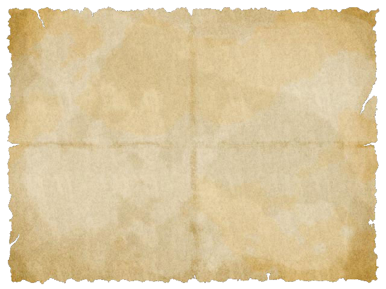

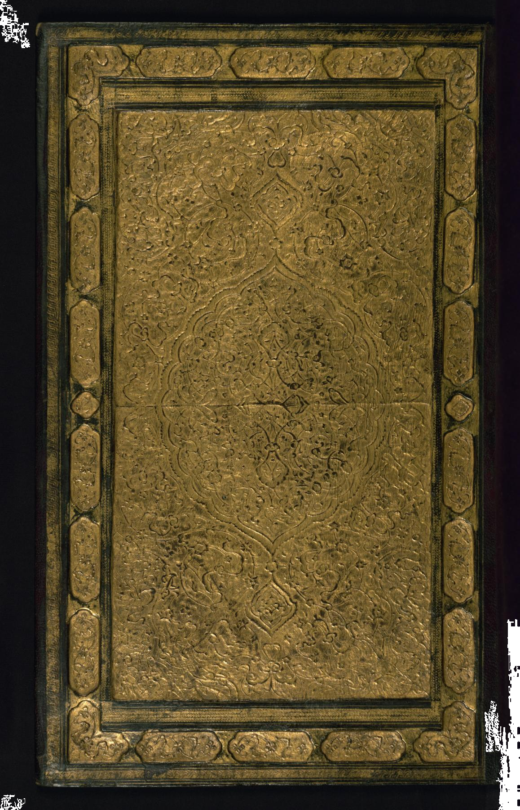

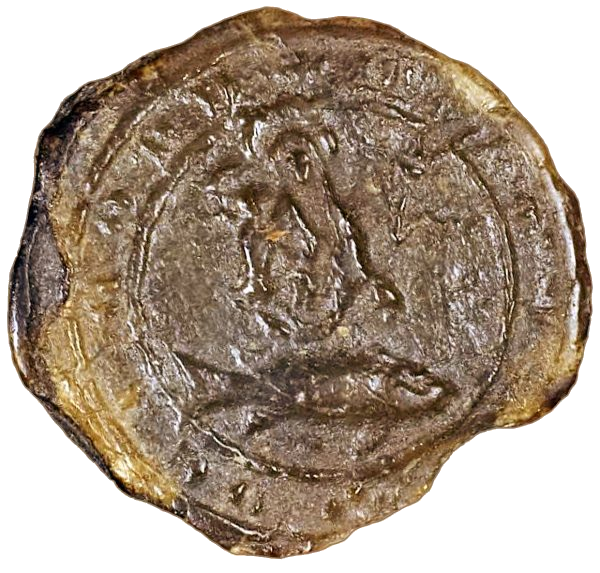

- Sayfa: cron, CC0, OpenGameArt “Old Parchment Paper”.
- Kapak: Walters W610, kamu malı.
- Mühür: Sonta 1464, kamu malı. Aynı görüntü `ornament_seal.png` yuvasına da kondu.
- Süsler: `sus/` altında Lorc tüy, hokka, mühür, tomar, kitap, ayraç, terazi. CC BY 3.0.

## Lif

Düz, sık dokulu kâğıt. Kapak yıpranmış deri fotoğrafı. Dört deri ayraç aynı deriden kesildi. Mühür kırmızı balmumu; yazıt Latince ve tarih 1778, bu yüzden varsayılan değil.

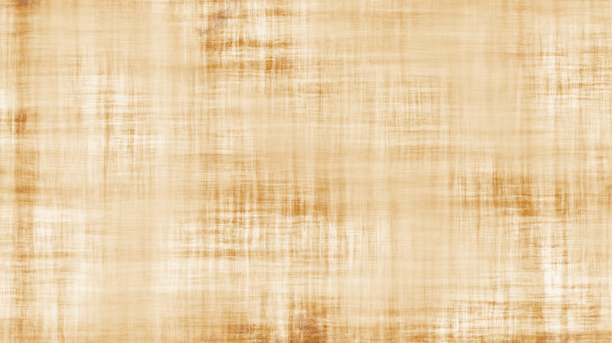

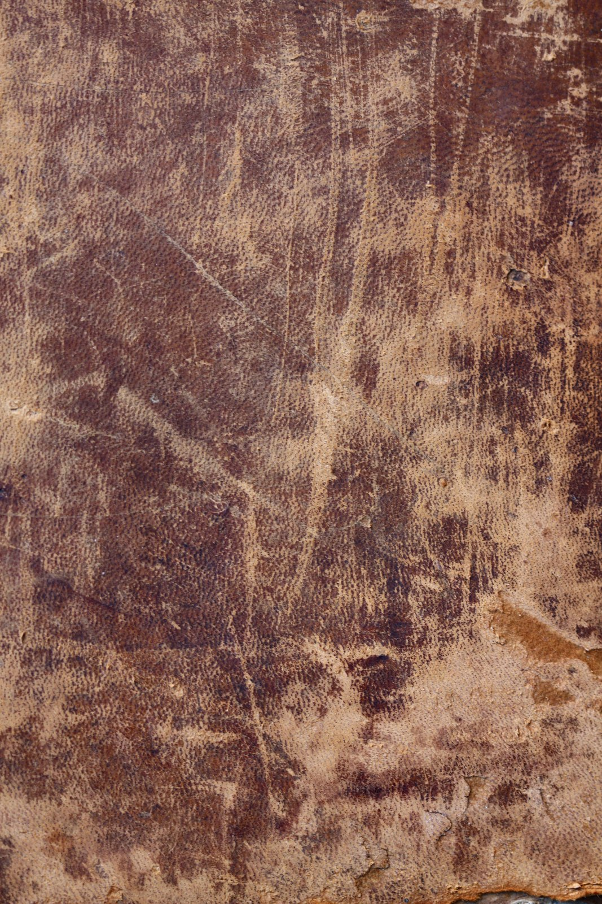

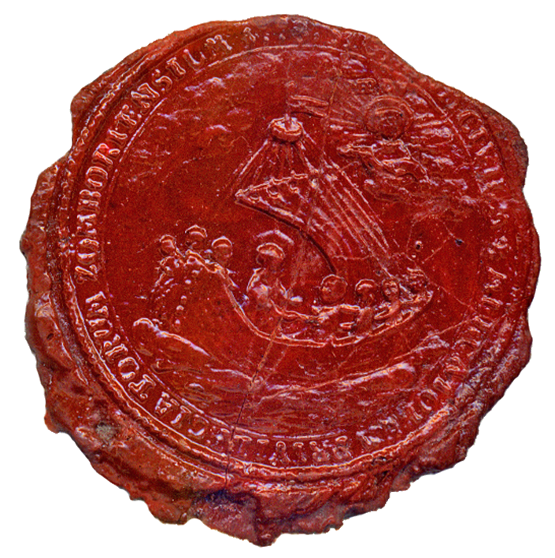

- Sayfa: Luke.RUSTLTD, CC0. Aynı liften 1024 kâğıt dokusu `paper_albedo.png`.
- Kapak ve ayraç: Pink Sherbet Photography, CC BY 2.0. Atıf lisans dosyasında.
- Mühür: Sombor tüccar loncası, kamu malı.

## Açık kitap

Boş iki sayfa ve yedi çevirme karesi. Kapak Hamse filigran cildi. Mavi-altın bezeme tarihi cildin kendi desenidir; düz Çini şablonu değildir. Ahmet bu kapağı istemezse klasör düşer, sayfa kareleri durur.

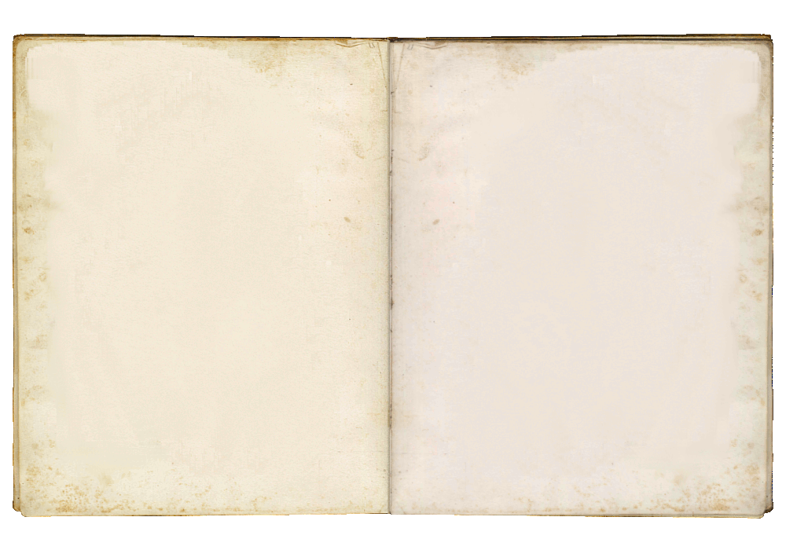

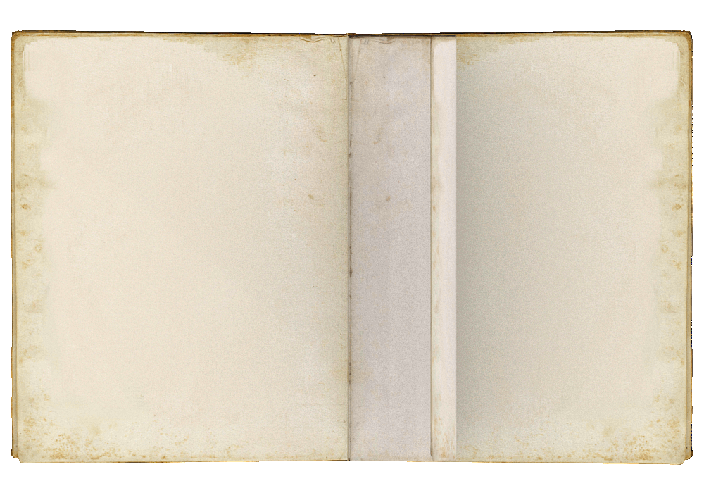

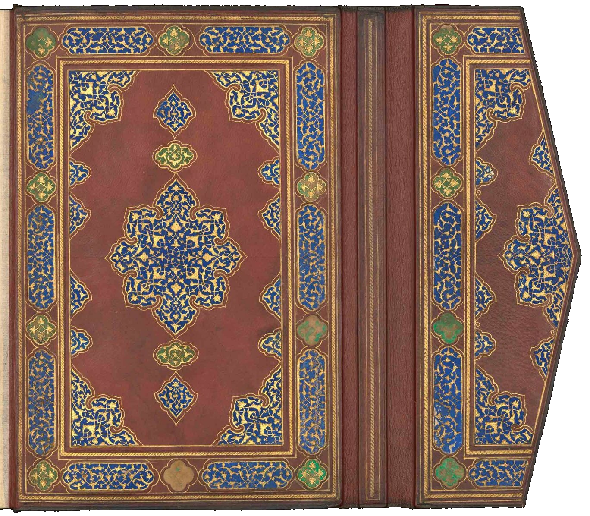

- Sayfa ve çevirme: yd, CC0. GIF kareleri PNG. İngilizce örnek sayfa alınmadı.
- Kapak: kamu malı Hamse cildi.
- Süsler: yırtık adayıyla aynı Lorc mürekkep ikonları.

## Diğer 2D

Fildişi mürekkep ikonları kaynak, eşya, yapı, mevsim ve savunma yuvalarına kondu. Boyalı akçe, harita, kart ve portre çerçevesinin üstüne yazılmadı. Buton, panel ve sekme temasına girilmedi.

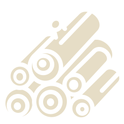

Yıpranmış tahta Poly Haven CC0, kâğıt lifinin karesi envanter doku yolunda. Kervansaray avlusu Bgag CC0; gündüz fotoğraf, gece menüsünün yerine geçmez.

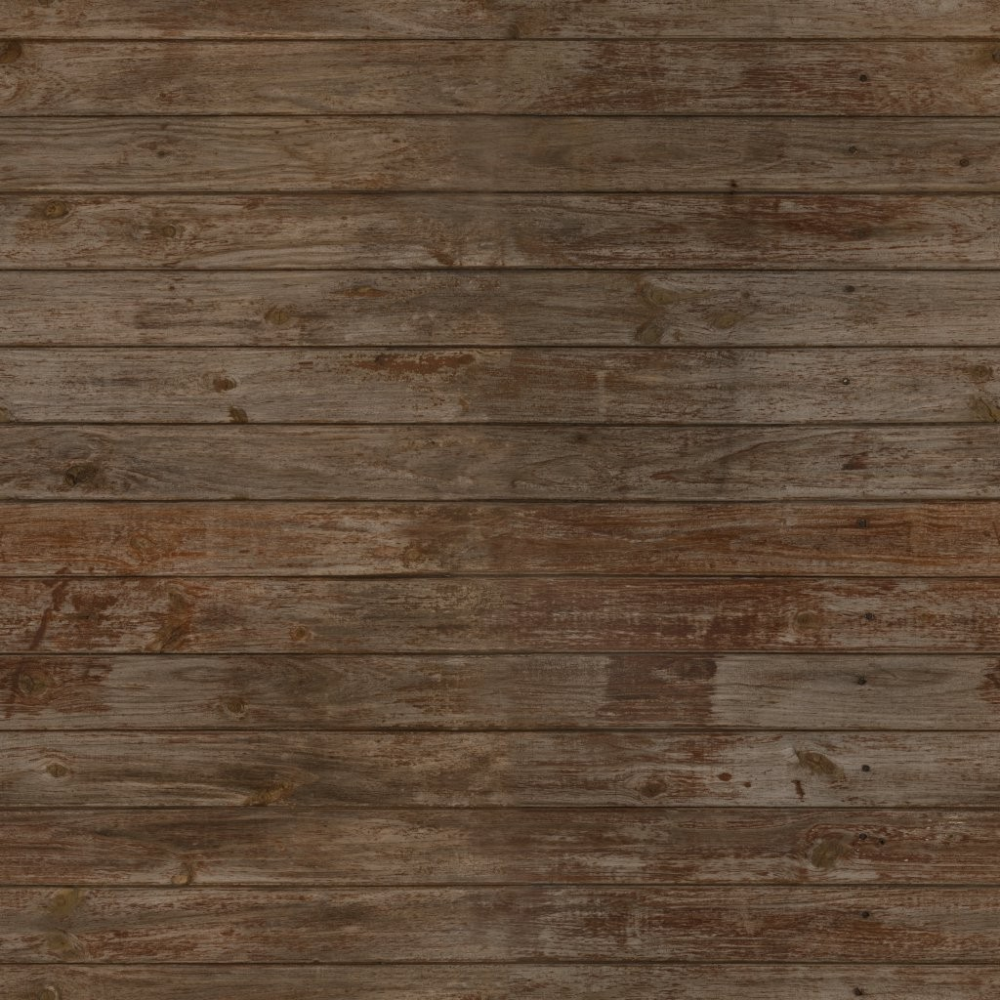

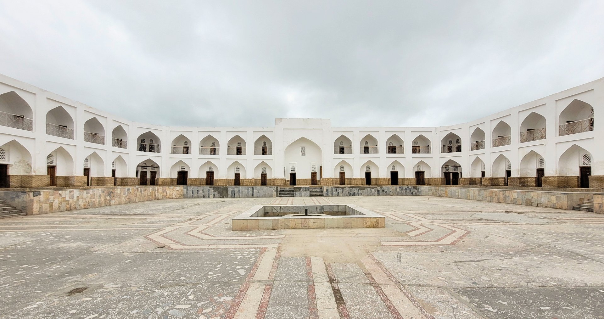

## Alınmayanlar

Modern döşeme derisi, düz giriş kutusu gibi parşömen, İngilizce kitap sayfası, ekmek, tuz, yüzük, ilkbahar, açlık, yorgunluk, zar ve adlı portreler için lisansı açık ve konuya uyan hazır görsel bulunmadı. Anlatılı yükleme ve son sahneleri açık. 3B yok.
