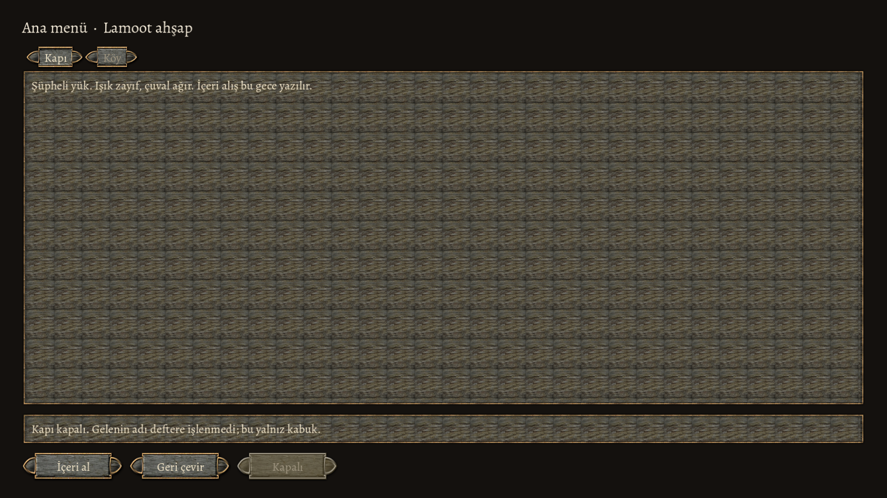
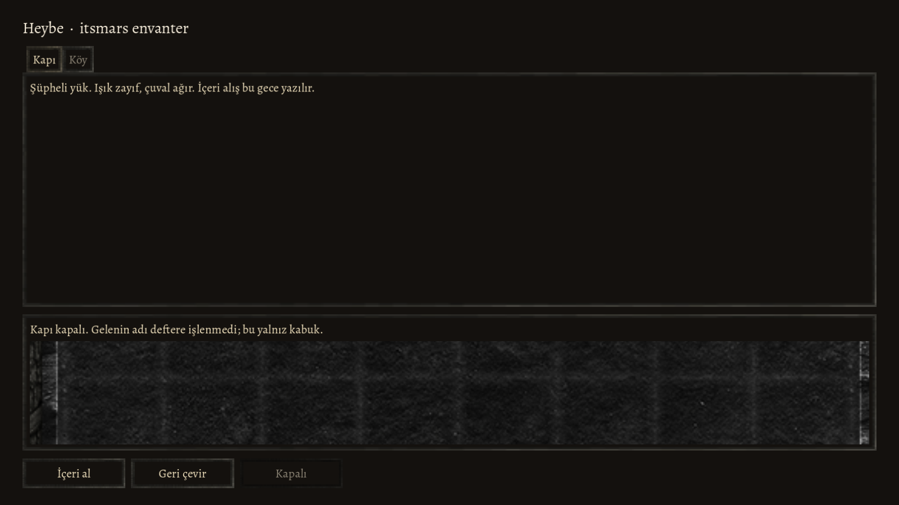
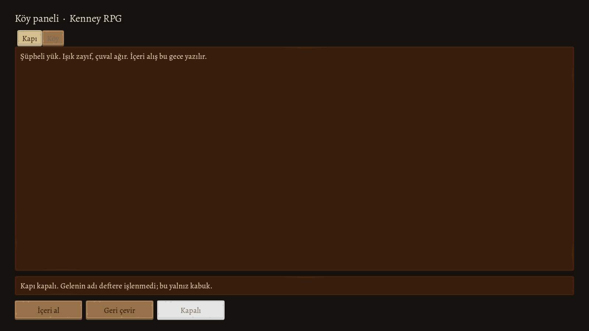
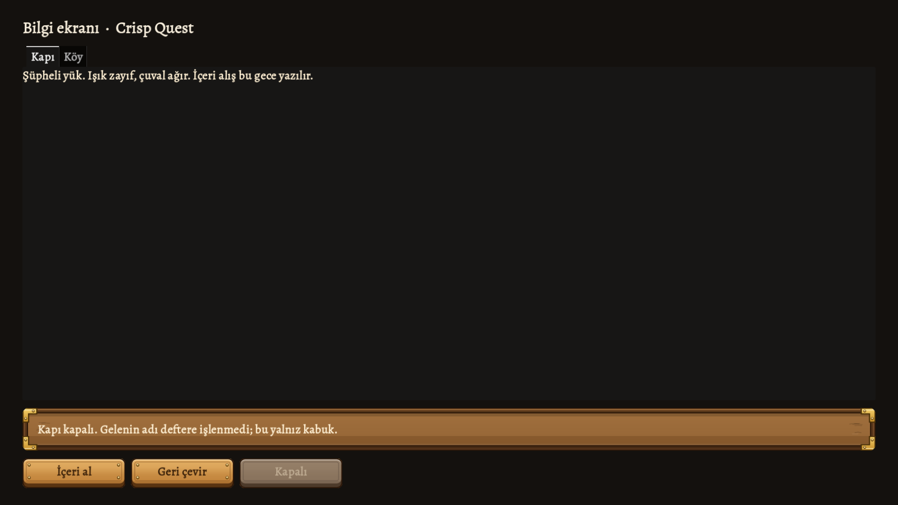
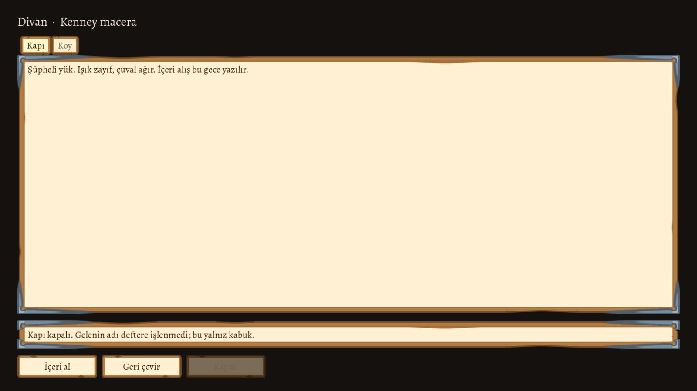

# UI adayları — sabah seçimi

3 Kasım 2026, Cursor. Ahmet birini seçecek; seçilen tema sonra bütün ekranlara uygulanacak. Bu turda her paket **ayrı bir ekranda** durur. Oyun kuralları, sinyaller ve ekran betikleri değişmedi. Bağlantı `src/arayuz/ui_adaylari/bagla.gd` autoload'udur (`AdayTema`). Test ve içe aktarma sırasında kapalıdır.

`tema.gd` ve `src/arayuz/tema/` durur. ARY-01 hâlâ Claude'da `[/]` ve seçim satırı boş. ARY-02'nin kendi kuralı seçim yokken temayı yazmayı yasaklar; bu yüzden madde `[/]` yapılmadı. Ayarlar (Bölüm 35), hafıza defteri (Bölüm 39), diyalog dosyaları ve köy ekonomi kodu bu işte yok.

Yeni görüntü üretilmedi. Yazı tipi depodaki Alegreya'dır (SIL OFL); Türkçe glifler durur. Gövde puntosu 26.

Önizleme: Godot'da `src/arayuz/ui_adaylari/onizleme.tscn` (F6).

## Adaylar

### 1. Lamoot ahşap — ana menü

- **Kaynak:** [RPG GUI construction kit v1.0](https://opengameart.org/content/rpg-gui-construction-kit-v10), zip `rpg_gui_v1.zip`
- **Yazar:** Lamoot
- **Lisans:** CC-BY 3.0. Ticari kullanım serbest, atıf zorunlu. Atıf: “RPG GUI construction kit v1.0 — Lamoot, CC-BY 3.0.”
- **Dosya:** `assets/ui_adaylari/lamoot_ahsap/tema.tres`
- **Ekran:** `menu_ekrani.gd`. Menü satırları kendi çizer; ahşap levha onların arkasında durur, tıklamayı yemez. Düğme kabuğu önizlemede görünür.
- **Neden:** Yıpranmış tahta ve ince altın kenar, kapı gecesine düz site arayüzünden daha yakın. Uçlu düğmeler ayrı bir oyun kabuğudur.
- **Değişiklik:** Sayfadan dört düğme durumu ve bir panel kesildi. Panel dokusu karo gibi tekrarlar; yeni çizim yok.

### 2. itsmars envanter — heybe

- **Kaynak:** [RPG Inventory](https://opengameart.org/content/rpg-inventory)
- **Yazar:** itsmars
- **Lisans:** CC0. OpenGameArt sayfası CC0 yazar. Zipte ayrı lisans dosyası yoktu; kayıt `LICENSE.txt` içindedir.
- **Dosya:** `assets/ui_adaylari/itsmars_envanter/tema.tres`
- **Ekran:** `heybe_paneli.gd`. Düğmeler yuva çerçevesi giyer. Tepsiye taş ızgara konur (`HeybePaneli.TEPSI`). Kartlar üstte kalır, ızgara tıklamayı geçirir.
- **Neden:** Karanlık taş ve ızgara, Diablo / Torchlight türü envanterdir. Kapıdaki heybe bakışıyla örtüşür. Düz parşömen şablonu değildir; sayfanın üstündeki parşömen alanı tepsiye konmadı, ızgara kondu.
- **Değişiklik:** Izgara bölgesi kesildi. 64×64 yuva çerçevesi nearest-neighbor ile 4 kat büyütüldü; pikseller aynıdır. PSD alınmadı.

### 3. Kenney RPG — köy paneli

- **Kaynak:** [UI pack: RPG extension](https://kenney.nl/assets/ui-pack-rpg-expansion), ayna [OpenGameArt](https://opengameart.org/content/ui-pack-rpg-extension)
- **Yazar:** Kenney Vleugels (kenney.nl)
- **Lisans:** CC0 1.0. Atıf zorunlu değil. Gönüllü: “Kenney”.
- **Dosya:** `assets/ui_adaylari/kenney_rpg/tema.tres`
- **Ekran:** `koy_ekrani.gd` içindeki doğrudan paneller (alt şerit, bilgi, bant, üst kart). `koy_ekrani.gd` dosyasına yazılmadı. HUD ve ekonomi hesabı aynı kaldı.
- **Neden:** Kahverengi RPG düğmesi ve panel, köy şeridinde tek bakışta oyun kabuğu olur. Mavi ve imleç parçaları alınmadı.
- **Sınır:** Üslup temiz ve çizgi film gibi. Anadolu kapısından uzak durabilir; seçim için duruyor.

### 4. Crisp Quest — bilgi ekranı

- **Kaynak:** [Crisp Quest Free](https://github.com/Anipixels/crisp-quest-free-theme), [Asset Library 5551](https://www.godotengine.org/asset-library/asset/5551), itch https://anipixels.itch.io/crisp-quest
- **Yazar:** Anipixels
- **Lisans:** PNG ve Theme **CC-BY 4.0**. Atıf: “Crisp Quest Free Theme by Anipixels — https://anipixels.itch.io/crisp-quest”. Betikler MIT; bu repoya betik alınmadı.
- **Dosya:** `assets/ui_adaylari/crisp_quest/tema.tres`
- **Ekran:** `bilgi_ekrani.gd` (perde, son, duraklat bilgisi). Ayarlar ekranı değil. Menü bu sınıftan türemesine rağmen kendi betiği olduğu için bu temayı giymez.
- **Neden:** Oyma ahşap, pirinç köşe ve hazır düğme durumları (normal, üstünde, basılı, kapalı) bilgi kadrajında okunur.
- **Yapım notu (yazar):** Şekiller, yapay zeka asistanıyla yazılmış kodla prosedürel çizilmiş. Görüntü üreteci yok. Bu repoda yeni görüntü üretilmedi.
- **Değişiklik:** 2x doku; dilim payları iki kat. Punto 26. Odak, ahşap düğmeyi silmez. Ücretsiz pakette sekme parçası yok; sekme şeridi sade kalır.

### 5. Kenney macera — divan

- **Kaynak:** [UI Pack - Adventure](https://kenney.nl/assets/ui-pack-adventure)
- **Yazar:** Kenney (kenney.nl)
- **Lisans:** CC0 1.0.
- **Dosya:** `assets/ui_adaylari/kenney_macera/tema.tres`
- **Ekran:** `divan_ekrani.gd`. Panelin gömülü düz kutusu kalkar, metal köşeli plaka gelir. Divan sinyalleri (`kapandi`, `kisi_secildi`) aynıdır.
- **Neden:** Krem zemin ve metal köşe, divan tutanağını bir levha gibi ayırır. RPG paketinden daha açık ve daha süslü.
- **Sınır:** Pakette plan, bilimkurgu pusula ve kırmızı afiş de var. Onlar alınmadı. Üslup yine Kenney çizgisi; seçilirse bütün oyuna yaymak cartoon bir kabuk yapar.

## Nasıl bakılır

Normal oyunda autoload ekranı açılınca temayı verir.

| Paket | Nerede görünür |
|---|---|
| Lamoot ahşap | Ana menü, yazıların arkasındaki levha |
| itsmars | Kapıda heybe açılınca tepsi ve düğmeler |
| Kenney RPG | Köy alt şeridi ve açılan kart |
| Crisp Quest | Bilgi / son / duraklat kadrajı |
| Kenney macera | Muhafız divanı paneli |

## Doğrulama

Godot **4.7.2.stable.official.ed1daf0bf**. Headless import bitti. `tests/unit/arayuz/ui_aday_tema_test.gd` çıktısı: `UI ADAY TEMA: GEÇTİ (0 hata)`. Beş temada düğme ve panel dokusu var, punto en az 26, Alegreya Türkçe glif taşıyor. Görüntüler xvfb ve OpenGL uyumluluk kipinde alındı. Tam sanity çalıştırılmadı. `SCRIPT ERROR` yok.

## Alınıp eklenmeyenler

Lisansı uymayan, üslubu düz site / parlak mobil olan ya da reddedilen parşömen şablonunu tekrarlayan paketler.

| Paket | Neden alınmadı |
|---|---|
| Kenney Fantasy UI Borders (CC0) | Çerçeveler geometrik tel; atmosferik RPG kabuğu değil. |
| Kenney genel UI Pack ve azagaya'nın Godot teması (CC0) | Düz, renkli, gündelik. Kapı gecesine uzak. |
| pzUH Free Fantasy Game GUI ve Medieval Game Button Pack (CC0, OpenGameArt) | Parlak yeşil/sarı mobil düğmeler, sosyal ağ ikonları, seviye ekranı. 13. yy kapı oyunu değil. |
| Pixelkiln Ironvale (itch ücretsiz örnek) | Ticari kullanıma izin var deniyor; yeniden dağıtım yasak. CC0 / CC-BY / MIT değil. |
| Arkana-FTS GUI | Sayfada GPL ve CC-BY birlikte. Karışık lisans alınmadı. |
| Unknown Horizons arayüzü | GPL. Bu oyunun lisansı GPL değil. |
| CraftPix ücretsiz bölüm | CraftPix'in kendi lisansı. CC0 / CC-BY / MIT değil. |
| Pixel UI Fantasy Free (CC-BY, heyheythere) | Parşömen piksel kabuğu. Reddedilen Parşömen şablonunun yönü. Ayrıca grafiklerde yapay zeka yardımı yazıyor. |
| sarbot “RPG UI Elements CC0” sayfası | Tek paket değil, link listesi. Parşömen dokuları aynı reddedilen yöne gider. |
| Lamoot ay modu (CC-BY, yalnız GIMP kaynağı) | Hazır düğme yok; asıl kit zaten aday 1. |

Çini, Parşömen ve Ocak düz renk şablonları kopyalanmadı.
