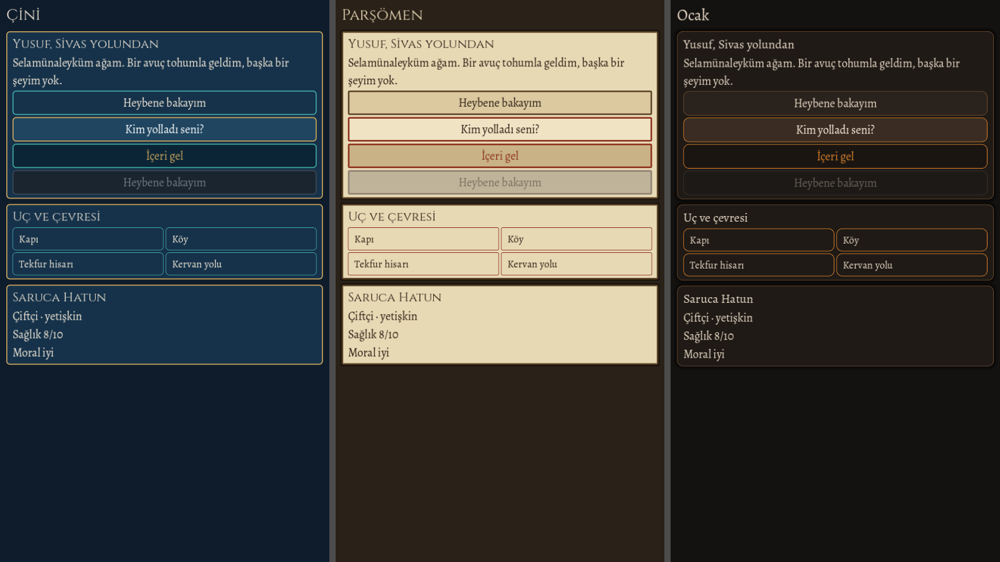

# Görsel dil şablonları (ARY-01)

Üç şablon aşağıda. Her biri önizleme sahnesinde (`src/arayuz/tema_onizleme.tscn`) sorgu, harita ve köylü kartı yer tutucusunda açılır; oyun ekranları bu maddede değişmez. Değerler `data/arayuz/tema_sablonlari.json` ile birebir aynıdır (`tests/tools/test_tema_sablonlari.py`). Doku ve yazı tipi üretilmez: yer tutucu `StyleBoxFlat`, yazı tipleri depodaki Alegreya ve Cinzel'dir (OFL). Gereken doku/çerçeve/yazı tipi envanterde `ARY01-*` satırındadır.

Önizlemeyi açmak: Godot'da `src/arayuz/tema_onizleme.tscn` sahnesini çalıştır (F6). Görüntü almak: `godot --path . res://src/arayuz/tema_onizleme.tscn -- --onizleme-foto <yol.png>`.

**Seçim yapılana kadar** `tema.gd` renk değiştirmez ve `src/arayuz/tema/` klasörü oluşmaz; ARY-02 başlamaz.

## Çini (`cini`)

- **Renk:** zemin `#0F1C2B`, zemin üstü yazı `#F2E9D8`, panel `#16324A`, metin `#F2E9D8`, vurgu `#3FA7A3`, çerçeve `#C9A45C`
- **Çerçeve:** kalınlık 2 px, köşe 6 px
- **Yazı tipi ailesi:** başlık Cinzel, gövde Alegreya
- **Panel dokusu:** düz renk StyleBoxFlat, altın ince kenar, köşe yuvarlak; gölge 0 px
- **Düğme durumları:**

| Durum | Zemin | Kenar | Metin |
|---|---|---|---|
| Normal | `#16324A` | `#3FA7A3` | `#F2E9D8` |
| Üstünde | `#1F4560` | `#C9A45C` | `#FFFFFF` |
| Basılı | `#0B2536` | `#3FA7A3` | `#C9A45C` |
| Kapalı | `#1A2530` | `#3A4652` | `#6E7A86` |

## Parşömen (`parsomen`)

- **Renk:** zemin `#2A2118`, zemin üstü yazı `#E8D9B5`, panel `#E8D9B5`, metin `#2B1D12`, vurgu `#8C2F1C`, çerçeve `#5C4326`
- **Çerçeve:** kalınlık 3 px, köşe 2 px
- **Yazı tipi ailesi:** başlık Cinzel, gövde Alegreya
- **Panel dokusu:** düz renk StyleBoxFlat, kalın kahve kenar, keskin köşe; gölge 4 px
- **Düğme durumları:**

| Durum | Zemin | Kenar | Metin |
|---|---|---|---|
| Normal | `#DCC9A0` | `#5C4326` | `#2B1D12` |
| Üstünde | `#F0E3C4` | `#8C2F1C` | `#2B1D12` |
| Basılı | `#C9B386` | `#8C2F1C` | `#8C2F1C` |
| Kapalı | `#BFB39A` | `#8E8170` | `#7A6E5E` |

## Ocak (`ocak`)

- **Renk:** zemin `#141210`, zemin üstü yazı `#EADBC8`, panel `#1F1A16`, metin `#EADBC8`, vurgu `#D9822B`, çerçeve `#6B4A2E`
- **Çerçeve:** kalınlık 1 px, köşe 10 px
- **Yazı tipi ailesi:** başlık Alegreya, gövde Alegreya
- **Panel dokusu:** düz renk StyleBoxFlat, ince kor kenar, yumuşak köşe; gölge 8 px
- **Düğme durumları:**

| Durum | Zemin | Kenar | Metin |
|---|---|---|---|
| Normal | `#2A221C` | `#6B4A2E` | `#EADBC8` |
| Üstünde | `#3A2C22` | `#D9822B` | `#FFF1DF` |
| Basılı | `#1A1511` | `#D9822B` | `#D9822B` |
| Kapalı | `#1C1916` | `#3A332D` | `#6A615A` |

## Renk çiftleri

Her şablonun (zemin, vurgu) çifti diğerlerinden ayrıdır: Çini `#0F1C2B`/`#3FA7A3`; Parşömen `#2A2118`/`#8C2F1C`; Ocak `#141210`/`#D9822B`. İki şablon aynı çifti kullansaydı üçüncüsü ayrışmak zorunda olurdu; şu an çakışma yok.

## Seçim

Berk ve Ahmet aşağıya şablonun kimliğini ve adlarını yazar. Satır boşken oyun teması değişmez.

- Seçilen şablon: 
- Berk: parsomen (Parşömen)
- Ahmet: 
